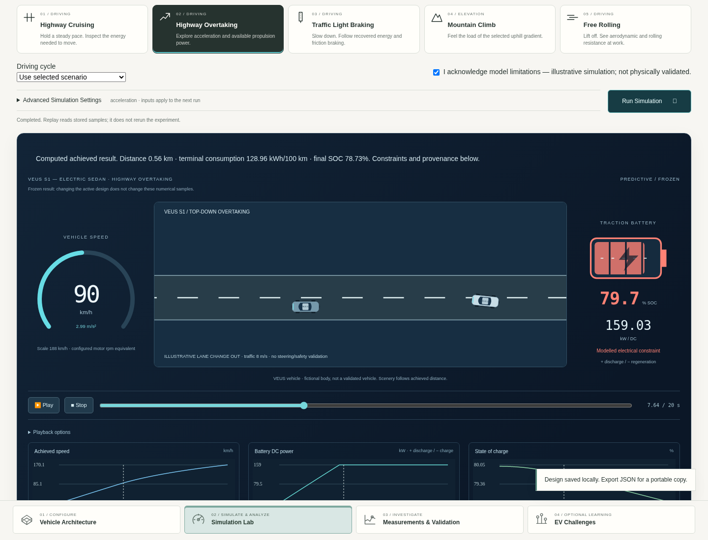
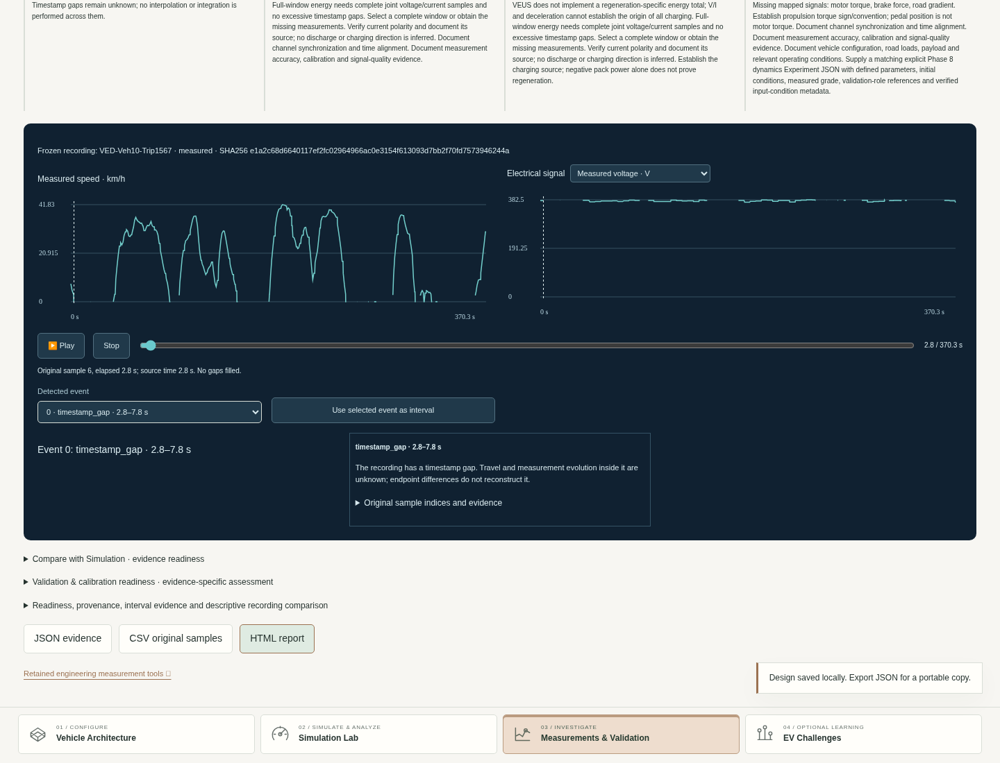

# VEUS — EV Longitudinal Simulation & Measurement Analysis Workbench

**Configure → Simulate → Analyze → Investigate Measurements**

Configure an EV, simulate its longitudinal behaviour, investigate energy/performance,
and assess what real measurements can support. VEUS demonstrates reproducible vehicle
simulation, powertrain modelling, data analysis and evidence-specific validation readiness.
It targets EV powertrain, vehicle simulation, model-based development and testing roles.

[Three-minute engineering demonstration](docs/refocus/workflow.md) ·
[Refocus verification, performance and actual captures](docs/refocus/evidence/README.md)

**Version 3.0.0rc1 — release candidate for review.** Development remains on
`feature/veus-2.0-engineering-workbench`; no stable release or merge to `main` is implied.
Physical vehicle validation remains **INCONCLUSIVE**.


## Four connected workspaces

| Workspace | Engineering task |
| --- | --- |
| **Vehicle Architecture** | Inspect the interactive cutaway, select S1/R1/X1 and configure basic vehicle assumptions. Component limits and advanced analysis remain expandable. |
| **Simulation Lab** | Choose a scenario or driving cycle, run the active configuration and inspect achieved speed, battery power, SOC, energy and constraints. |
| **Measurements & Validation** | Select bundled or imported data, preview real signals, investigate events, assess comparison readiness and export evidence. |
| **EV Challenges** | Optional interactive aero/speed, battery mass/capacity and regeneration examples, plus retained source-referenced explanations. |

The active design is shared across workspaces. Preset cards select the active configuration directly; unsaved edits require confirmation
before replacement. Saved records are preserved. Saved designs, unsaved edits and frozen calculated results are labelled.
The browser-local library holds up to **16 designs / 180 KB**; export JSON for portable
backup. Storage is specific to the browser and origin. Legacy v1 designs require manual
reconstruction because their mass boundary differs.

## Three illustrative vehicle classes

These are fictional engineering configurations, not manufacturer specifications.

| Preset | Body | Usable battery | Continuous / peak motor | Total model mass |
| --- | --- | ---: | ---: | ---: |
| **S1** | Electric sedan | 60 kWh | 145 / 180 kW | 1,750 kg |
| **R1** | Performance EV | 90 kWh | 300 / 450 kW | 1,950 kg |
| **X1** | Family SUV | 100 kWh | 180 / 250 kW | 2,450 kg |

All use a single equivalent drive unit. Peak ratings do not establish sustained power,
AWD, downforce or a validated maximum speed. Battery chemistry and component labels do
not determine electrical performance; explicit parameters and limits do.

## Engineering capabilities

- **Coupled experiments:** cruising, acceleration, braking/regen, gradient and coasting;
  battery current/SOC and drivetrain constraints; requested versus achieved demand.
- **Profiles and routes:** illustrative cycles, sourced FASTSim UDDS/HWFET, bounded
  imports, explicit coordinate/elevation coverage and preserved source provenance.
- **Powertrain options:** exact legacy constant-efficiency mode by default, or an
  explicitly selected illustrative RPM/torque efficiency map with separate losses,
  defined operating region and no silent extrapolation.
- **Engineering Insights:** cycle stored-energy consumption, gated cycle-equivalent
  range, continuous-rating acceleration and explicit daily energy/tariff assumptions.
- **Controlled comparisons:** identical conditions, frozen snapshots, changed inputs,
  bounded parameter sweeps and explicit battery mass/capacity trade-offs; no optimizer.
- **Measured evidence:** genuine Nissan Leaf VED recordings, source hashes, signal
  quality, shared replay cursor, event/interval findings and JSON/CSV/HTML reports.

Driving scenes reconstruct deterministically from recorded time and distance. Traffic,
lateral movement and camera effects are illustrative; they do not validate steering,
sensor detection, collision avoidance or autonomous driving.

## Install and run

Use **Python 3.12** and Git. From Windows PowerShell:

```powershell
git clone --branch feature/veus-2.0-engineering-workbench https://github.com/AsherFerdinand/VEUS-ev-testbench.git
Set-Location VEUS-ev-testbench
py -3.12 -m venv .venv
.\.venv\Scripts\python.exe -m pip install -r requirements-report.txt
.\.venv\Scripts\python.exe -m uvicorn veus.studio.main:app --port 8770
Start-Process 'http://localhost:8770'
```

Keep the server terminal open; use a second PowerShell window for `Start-Process`,
or open the URL manually. No activation script, administrator rights, WSL, Docker,
GPU, account or frontend build is required. Report dependencies support plot exports.

On Linux/macOS use `python3.12 -m venv .venv`, then `.venv/bin/python` in place of the
Windows executable. In an Anaconda environment with Python 3.12 selected, the same
`python -m pip ...` and `python -m uvicorn ...` commands work from the project root.

[Windows setup, updates and troubleshooting](docs/windows-installation.md).
Commands are based on the actual source/package structure and tested Linux environment;
**clean Windows installation has not been executed**.

## Tests and reproducibility

```powershell
.\.venv\Scripts\python.exe -m pip install -r requirements-dev.txt
.\.venv\Scripts\python.exe -m pytest -q
.\.venv\Scripts\python.exe -m veus.testing physics --output reports/physics-review
```

Use a new report directory. Some example scenarios intentionally fail declared criteria;
that recorded outcome is distinct from an implementation-test failure or a safety claim.

JavaScript clock/scene checks require Node.js:

```powershell
node --test tests/browser/replay-controller.test.cjs tests/browser/driving-scene-state.test.mjs
```

Browser tooling is optional and is not a runtime dependency. The final regression covers
**314 Python tests, 9 clock tests, 8 scene tests and 11 browser suites**. See the
[verification and performance evidence](docs/refocus/evidence/README.md) for exact scope,
commands, hashes and limitations. Only Chromium has been exercised in this environment.

Engineering exports preserve supported model versions, configuration/source hashes,
resolved snapshots, assumptions, units and calculation status. Legacy numerical and
measurement-report parity are regression checked. Old saved results are not reinterpreted
when a different powertrain model is selected. API/schema/model versions remain separate
from the application release-candidate version.

## Genuine application views

These are actual Chromium captures of the refocused application.





## Architecture and engineering limits

The lightweight frontend handles configuration, original SVG geometry and replay; Python
owns calculations. Shared design contracts connect backend APIs to the coupled simulation,
optional powertrain maps, engineering analysis and existing measurement/report services.
[Current architecture diagram](docs/veus2/architecture.md) · [Repository map](docs/REPO_MAP.md).

Models use simplified longitudinal dynamics and fixed battery OCV/resistance. Thermal,
ageing, auxiliaries, charging curves, lateral dynamics and commercial product costing
are not implemented. Range extrapolates a declared cycle and usable model reservoir;
it is neither certified range nor current-SOC remaining range. SOH alone cannot supply
voltage, resistance or power limits.

Current VED evidence lacks an independently matched vehicle configuration, verified
polarity, synchronization and measurement uncertainty. Validation/calibration readiness
therefore reports blockers and null fitted values/residuals. No real-data calibration,
fully validated digital twin, production ADAS or safety certification is claimed.

- [Powertrain equations and boundaries](docs/veus2/powertrain2.6.md)
- [Simulation Lab](docs/veus2/simulation-lab.md) · [Profiles/routes](docs/veus2/profiles-routes.md)
- [Design contracts and mass accounting](docs/veus2/design-engineering.md)
- [Analysis and controlled comparisons](docs/veus2/engineering-analysis.md)
- [Measurement parity](docs/veus2/measurement-migration.md) · [Validation/driving limits](docs/veus2/validation-driving2.6.md)
- [Release readiness and outstanding checks](docs/veus3/release-readiness.md) · [Current checkpoint](docs/PROGRESS.md)

The retained toolset remains at **http://localhost:8770/engineering**; its APIs, ADAS
scenarios and historical reports are preserved outside the primary four-workspace flow.
The pre-2.0 implementation also remains on `archive/veus-pre-2.0`.

## Licensing and third-party data

No root project licence is currently present. A repository-owner licensing decision is
required before representing VEUS as an open-source release. No licence was added or
changed during release preparation. VED and FASTSim-derived cycle materials retain their
upstream licences, notices and modification/provenance records under `datasets/`.
See the [licensing review](docs/veus3/release-readiness.md#licensing-and-third-party-materials).
