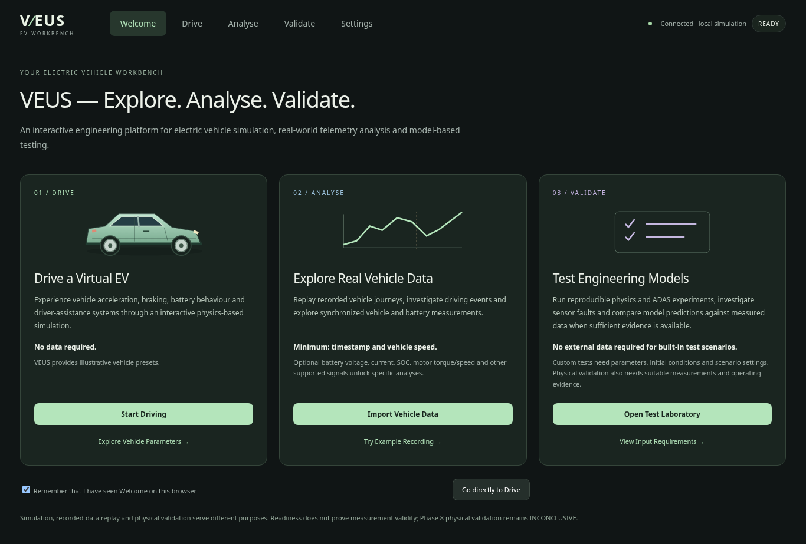
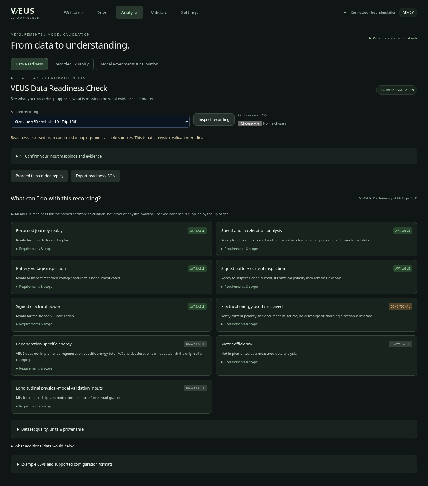
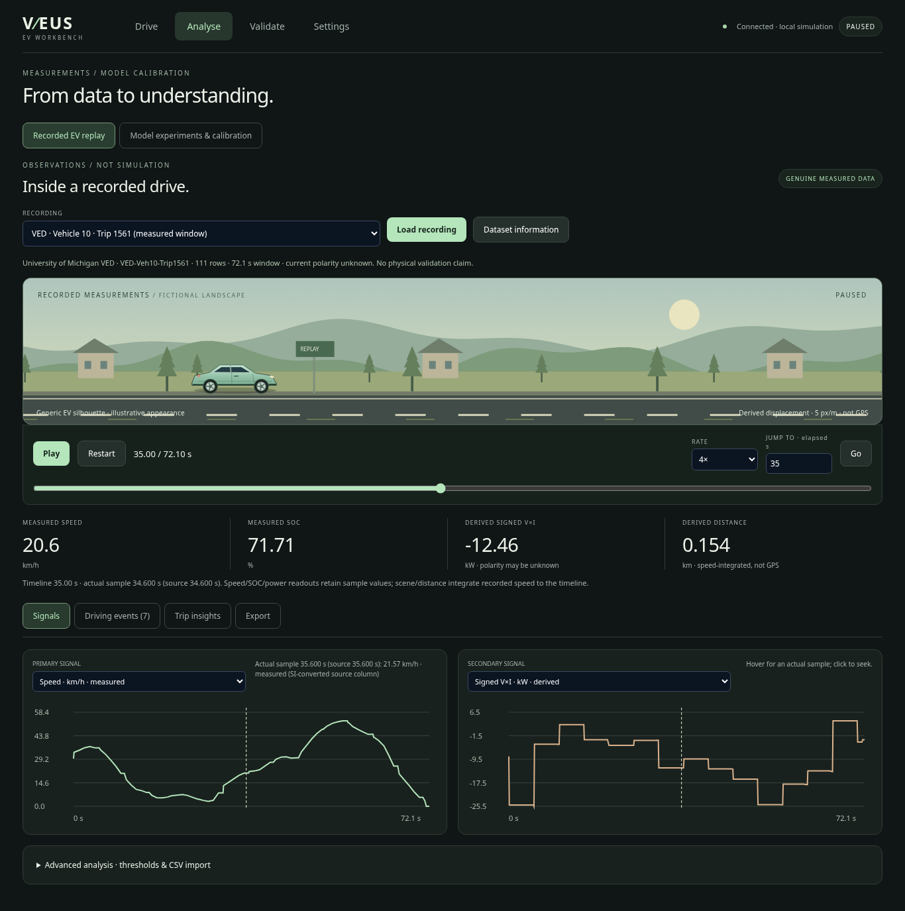
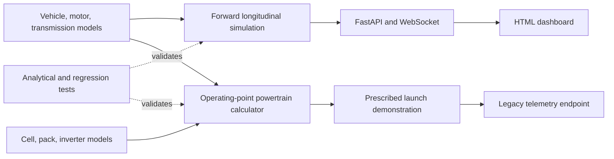

# VEUS — EV Simulation Workbench

VEUS is an educational Python vehicle simulation project. The current version provides a
forward longitudinal dynamics model, reusable EV component calculations,
a constant-OCV battery energy model, regenerative brake blending, analytical
regression tests, and an interactive FastAPI dashboard. Parameters
are illustrative and uncalibrated. This is not a production ADAS or safety tool.

## Quick start

From the repository folder in **Anaconda Prompt**:

```bat
python -m pip install -r requirements-report.txt
python -m uvicorn veus.studio.main:app --port 8770
```

Open **http://localhost:8770**. Welcome explains the three workflows; direct
navigation stays available, and a local browser preference skips repeat onboarding.
No account or vehicle-data upload is needed to drive.



## Choose Your Workflow

| Workflow | Purpose and example | Required / optional inputs | Outputs and guide |
|---|---|---|---|
| **Drive** | Drive a simulated EV; try acceleration, coasting and braking. | **No data required.** Illustrative presets are supplied. Optionally customize supported vehicle, battery, road and controller settings. | Simulated telemetry, charts and CSV/run metadata. [Drive guide](docs/drive-experience.md) |
| **Analyse** | Replay a recording; inspect an event and its battery measurements. | **Replay needs timestamp + speed in CSV.** Optional voltage/current/SOC and other supported signals enable specific analyses. Columns, units and source origin must be confirmed. | Synchronized observations, derived quantities, threshold events and descriptive reports. [Readiness](docs/data-readiness.md) · [Replay](docs/real-world-replay.md) |
| **Validate** | Verify equations or run existing ADAS/sensor experiments. | **Built-in scenarios need no external data.** Custom tests need model parameters, initial conditions and supported scenario JSON. Physical validation additionally needs independent measured inputs/outputs, units/times and documented conditions. | Defined scenario/reference checks and engineering reports. [Verification](docs/validation.md) · [Model evaluation](docs/vehicle-validation.md) |

[Welcome, preferences, examples and step-by-step workflows](docs/user-onboarding.md).
Model experiments/calibration remain accessible in Analyse; Validate contains the
simulation laboratory, sensors and scenario/report instructions.

## What Data Does VEUS Need?

Recorded replay starts with numeric timestamps and speed. This **synthetic** CSV
illustrates the format; it is not measured vehicle evidence:

```csv
time_s,speed_kmh
0,0
1,3.6
2,7.2
3,10.8
```

Use **Analyse → Data Readiness** to inspect a CSV, correct proposed mappings,
confirm units and measured/synthetic origin, then see AVAILABLE / CONDITIONAL /
UNAVAILABLE capabilities. Recognized columns do not establish accuracy,
synchronization, polarity or physical validity. For example, VED supports replay
and signed V×I; energy remains conditional and physical-model validation inputs
remain unavailable. Phase 8's INCONCLUSIVE conclusion is preserved.

Supported imports are **UTF-8 CSV measurements plus JSON configuration**, not
arbitrary JSON telemetry. Time is numeric s/ms, with strictly increasing unique
values; units/sign mappings are explicit. Interactive recordings are bounded at
2 MB / 5000 rows / one day. Electrical-only time/V/I data can be inspected without
speed, but cannot replay a journey. No pedal-to-torque/brake-force conversion is
assumed. [Supported signals, quality checks and exact rules](docs/data-readiness.md).

- **A — Basic replay:** [synthetic CSV](examples/onboarding/basic-replay.csv) and [ReplayConfig](examples/onboarding/basic-replay.json).
- **B — EV electrical analysis:** [synthetic CSV](examples/onboarding/electrical-analysis.csv) and [ReplayConfig](examples/onboarding/electrical-analysis.json).
- **C — Existing engineering example:** [synthetic battery reference CSV](examples/validation/synthetic-battery-train.csv), [Phase 8 Experiment](examples/validation/synthetic-battery-train.json) and [fitting settings](examples/validation/battery-calibration.json). This is the existing model experiment format, not a universal replay schema.

Attachment downloads are also available inside Data Readiness. Genuine licensed
VED examples remain bundled with their [source/licence record](datasets/ved/README.md).

<details><summary>See the readiness interface and execution evidence</summary>



[Tests, example assessments and mobile screenshots](docs/phase10-1-evidence/README.md).

</details>

<details><summary>Drive and recorded replay implementation examples</summary>

## Recorded EV replay · Phase 10

Open **Analyse → Recorded EV replay** to inspect genuine VED Vehicle 10 records.
Play, pause, scrub, change playback rate, click graphs or jump to a detected event.
Sample readouts and graph cursors stay synchronized with a generic EV illustration.
The scenery follows distance derived from recorded speed, with gaps left unknown.



The default 111-row trip 1561 window contains speed, pack voltage, signed current,
SOC and outside air temperature over 72.1 s. Its speed integral is approximately
493 m. Acceleration and signed V×I are derived; current polarity remains unknown,
so energy-use and regeneration claims are unavailable. This is descriptive
measurement analysis, not a simulated prediction or physical validation.

Export summary/events/settings/full-resolution JSON and a standalone HTML analysis.
The prior calibration workflow remains under **Model experiments & calibration**;
its INCONCLUSIVE physical-validation findings remain unchanged.

[Dataset provenance, calculations, controls and exact commands](docs/real-world-replay.md)
· [Executed evidence and screenshots](docs/phase10-evidence/README.md)

## VEUS Drive · Phase 9

Choose an illustrative EV, press **Run**, and hold **W / ↑** to accelerate or
**S / ↓** to brake. **Space** pauses/resumes; **R** resets. Sliders and hold buttons
support mouse/touch. Brake demand takes priority. Inputs release on focus loss or
workspace changes. The control bar sits directly below the road.


**Drive** contains the 2D scene and essential telemetry. **Analyse** retains
measurement comparison and calibration. **Validate** retains advanced settings,
sensors/faults, complete charts and exports, with scenario/report CLI instructions.
**Settings** offers paint selection and model limitations.


The four presets change backend mass, motor limits and battery capacity along
with their original SVG silhouettes. They are not manufacturer specifications.
Scenery and wheel rotation follow received Python displacement; bounded visual
interpolation smooths updates without changing physics. This remains a simplified
longitudinal simulation, with no steering, lateral dynamics or suspension model.
Real-world vehicle validation remains pending.

[Controls, preset specifications and frontend architecture](docs/drive-experience.md)
· [Browser evidence, screenshots and performance limits](docs/phase9-evidence/README.md)

</details>

## Development setup

Python 3.12 is validated. From the repository root on Windows:

```powershell
py -3.12 -m venv venv
.\venv\Scripts\python -m pip install -r requirements-dev.txt
.\venv\Scripts\python -m pytest -q
.\venv\Scripts\python test_run.py
.\venv\Scripts\python -m uvicorn veus.studio.main:app --port 8770
```

Open the dashboard at the server's local address on your own machine. On Linux,
create the environment with `python3 -m venv venv` and use `venv/bin/python`.
For the fully pinned tested dependency set, install `requirements-lock.txt`.
No GPU, external service, credentials, or vehicle hardware is required.

## Two simulation workflows

`VehiclePowertrain.solve_point()` calculates required powertrain demand for a
specified speed, acceleration and SOC. `test_run.py` demonstrates this inverse
calculation. It does not predict achieved acceleration.

`LongitudinalSimulator.step()` predicts motion from motor torque and friction
brake commands. It reuses the vehicle, motor and transmission models, applies
motor and road traction limits, and integrates speed and position.

```python
from veus.sim.dynamics import LongitudinalSimulator, VehicleState

sim = LongitudinalSimulator()
state = VehicleState()
for _ in range(100):
    result = sim.step(state, motor_torque_nm=300, brake_force_n=0, dt_s=0.01)
    state = result.state
print(state)
```

The dashboard now runs the forward mechanical simulation. Select manual driving,
full-throttle acceleration, braking from 80 km/h, or coast-down. Set mass, motor
power/torque, friction, road gradient, starting speed and duration; click **Apply &
reset**, then **Run**. In manual mode, adjust throttle and brake live. Brake
commands override throttle. Pause/resume retains state; reset starts a new run.
Plots show speed, acceleration, mechanical motor power and torque. CSV and JSON
metadata exports are available. Use 0.9 versus 0.1 friction to compare braking,
or change vehicle mass to compare acceleration. Defaults represent an illustrative
1,800 kg / 150 kW / 300 Nm EV, not a calibrated production vehicle.

Each browser tab owns an independent simulation, with 0.01 s physics steps and
0.1 s telemetry frames at nominal 1× playback. Slow networks can slow playback;
simulation time is authoritative. Runs stop after 1–120 s. Closing the tab loses
server state; export results before reloading. Live pedal-command history is not
recorded, so exported manual runs are not yet fully replayable. Battery energy, SOC, charge/discharge limits and regenerative brake blending are
implemented. Simplified cruise control, ACC and AEB are available. Offline scenario reports now provide explicit numerical acceptance criteria;
see the reproducible verification workflow below.

The old prescribed launch is retained at `/ws/telemetry` for compatibility;
the dashboard uses `/ws/simulation`. The old launch has fixed SOC and is a
repeating demonstration, not the new interactive simulation.

## Architecture



See [engineering assumptions and validation](docs/engineering.md) for equations,
limitations, test evidence and the remaining roadmap.


## Battery and energy experiments (Phase 2)

Expand **Battery & energy settings**, edit capacity/initial SOC/current limits and
regeneration settings, then **Apply & reset**. Battery power is positive during
discharge and negative during charging. Compare braking from 80 km/h with regen
on/off, or with initial SOC=1: friction brakes preserve stopping demand when the
pack cannot accept charge. An initial SOC of zero disables powered acceleration.
Lower the discharge-current limit to see battery-limited acceleration.

The dashboard shows SOC, terminal voltage/current/power, consumed and recovered
energy, regenerative/friction brake force, and an energy-accounting residual.
CSV exports include cumulative battery/conversion/braking losses and road work.
The battery uses fixed OCV with resistance, not a detailed chemistry model.
Motor/inverter efficiencies are constant; transmission efficiency is applied
separately in both directions. No auxiliary loads or thermal dynamics yet.


### Inspecting small SOC changes

The SOC plot spans the available width and automatically zooms its vertical axis
around the measured SOC, with three-decimal tick labels. It is explicitly not a
zero-based axis. The SOC card reports change from run start in percentage points,
so a rise from 80.000% to 80.072% is shown as +0.072 percentage points. Each chart
has an **Expand** button for a large dialog view; use **Close graph** or Escape
to return. Physics and recorded telemetry are unchanged by display zoom.


## ADAS experiments (Phase 3)

Choose one of the controller experiments, **Apply & reset**, then **Run**:

- **Cruise control**: target 80 km/h from standstill; run 30 s. Inspect ego speed
  against the dashed target line. Acceleration is constrained by motor, battery
  and tyre capability even when the controller requests more.
- **ACC**: ego initially 80 km/h, lead 60 km/h, gap 50 m. Compare actual gap with
  desired gap `standstill_gap + headway * ego_speed`. Lead speed remains constant.
- **AEB**: both vehicles start at 80 km/h, gap 35 m. The lead brakes at 3 s with
  6 m/s² deceleration. The ego uses cruise until the TTC/gap threshold triggers
  latched emergency braking. Try friction 0.9 versus 0.1 and compare outcomes.

Controller and lead settings include target speed, headway, TTC threshold,
detection/actuation delays and lead-braking timing. A lead-vehicle schematic,
following-gap plot, TTC plot, controller state, detection time, minimum gap and
collision indicator are provided. TTC is undefined when not closing, shown as
missing rather than zero. AEB stays latched until reset. Collision stops the run;
reset is required to restart. These algorithms demonstrate defined behaviours,
not production ADAS safety. ACC does not include AEB override in this increment.


## Reproducible verification and batch scenarios

The offline runner reuses the dashboard physics/controllers and records every
0.01 s tick. It accepts versioned JSON scenarios, including timed manual pedals,
and emits standalone HTML engineering reports, plots, metrics and raw CSV/JSON.

```bat
python -m pip install -r requirements-dev.txt
python -m pytest -q
python -m veus.testing physics --output reports/physics-001
python -m veus.testing run scenarios --output reports/batch-001
```

Open `reports/batch-001/report.html` in a browser. No running web server is needed.
Use a new output directory per run. **The example batch intentionally returns exit
code 1**: six scenarios pass, while delayed and low-grip AEB scenarios fail
collision avoidance. Those failures remain visible in the report. Exit 0 means
all checks passed; exit 1 includes FAIL or INCONCLUSIVE; exit 2 is an input/setup
error. Empty requirement lists and unavailable metrics never silently pass.

Reports preserve original and resolved scenario settings, source/config hashes,
software versions, all tick telemetry, TTC/minimum gap, first-overlap impact
speeds, brake onset/stop distances and controller response. Eleven analytical
reference traces include acceleration, braking, quadratic-drag coasting, gradient,
battery energy, coupled drive energy and regenerative energy, with documented timestep error bounds.
These are **equation/software verification**, not measured-vehicle validation.

- [Pre-change audit](docs/development-audit.md)
- [Equations, tolerances, metrics, output schema and Windows commands](docs/validation.md)
- [Future NASA capacity-SOH integration contracts and required evidence](docs/soh-integration.md)

SOH integration is an interface design only. Capacity SOH does not by itself
specify voltage, internal resistance or allowable battery power. No estimator,
NASA data fitting or unvalidated SOH-to-electrical-parameter mapping is included.

[Executed evidence and sample HTML report](docs/verification/README.md) includes
the actual reference plots, measured coverage and the two failed avoidance cases.
Download the repository and open the sample report HTML locally to view it.


## Virtual sensors and fault injection (Phase 7)

Virtual speed/radar sensors are optional and disabled by default. Enable them in
**Sensors & Fault Injection** to compare true/measured speed and gap, sampling,
noise, bias, latency and timed dropout/freeze events. Missing or stale observations
invoke explicit comfort-braking fallback; latched AEB stays active. No perfect
measurement is silently substituted. Sensor settings/RNG state reset per run.

```bat
python -m veus.testing run scenarios/sensors --output reports/sensors-001
```

The seven sensor cases are separate from the original eight-scenario baseline.
Current sensor examples retain three failures (radar bias, radar latency and speed
tracking under bias); reproducing a fault is not equivalent to meeting avoidance
or tracking requirements. Reports include valid-only error statistics, availability,
executed fault events and like-for-like ideal sensor comparisons.

[Architecture, timing/overlap/fallback rules and worked example](docs/virtual-sensors.md).
No new runtime dependency, hardware or ML library is required. This remains
software verification of illustrative models, not real-world sensor validation.

[Phase 7 execution evidence and sample report](docs/phase7-evidence/README.md)
records 109 passing tests, 96% combined Python coverage and all failed outcomes.


## Measurement comparison and calibration (Phase 8)

Studio now includes **Model Validation** for CSV imports, explicit experiment
configuration, original/calibrated comparisons, residuals, sensitivity sweeps and
portable HTML reports. Install optional reporting dependencies first:

```bat
python -m pip install -r requirements-report.txt
python -m uvicorn veus.studio.main:app --port 8770
```

The same experiments run offline; use a new output directory for each run:

```bat
python -m veus.validation calibrate examples/validation/synthetic-battery-train.json examples/validation/synthetic-battery-train.csv --settings examples/validation/battery-calibration.json --output reports/battery-fit
python -m veus.validation evaluate examples/validation/synthetic-battery-holdout.json examples/validation/synthetic-battery-holdout.csv --calibration reports/battery-fit/calibration.json --output reports/battery-holdout
```

Calibration uses designated training runs, bounded parameters and a local
identifiability guard. Independent evaluation rejects duplicate hashes/run IDs;
only learned parameters transfer. Synthetic examples test the pipeline.

**Real-world vehicle validation remains pending.** Small genuine University of
Michigan VED subsets are included with provenance and licence. Their exploratory
held-out voltage comparison improves after fitting, but still fails its numerical
target. Missing operating-condition evidence prevents a physical validation claim.
No measured propulsion/braking/grade dataset yet qualifies the full dynamics.
Existing physics, controllers, scenario criteria and sensor functionality remain.

- [Dataset discovery and suitability](docs/dataset-discovery.md)
- [Architecture and implementation plan](docs/phase8-plan.md)
- [Models, units, calibration, uncertainty and reproduction](docs/vehicle-validation.md)
- [Phase 8 execution evidence](docs/phase8-evidence/README.md)
