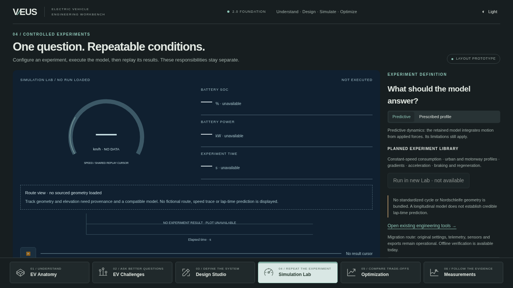

# VEUS — Electric Vehicle Engineering Workbench

**Understand · Design · Simulate · Optimize**

An EV engineering workbench for understanding vehicle systems, making explicit
design assumptions and investigating reproducible experiments and measured evidence.

**VEUS 2.5 Engineering Workbench** combines three fictional vehicle classes with
coupled-cycle insights, controlled design studies and a functional recorded-data
investigation workspace. Numerical range/cost results have explicit assumptions;
measurement readiness gates preserve unknown signals and polarity. This feature
branch is not a stable release. Physical validation remains **INCONCLUSIVE**.


## Five engineering workspaces

Designs persist in this browser (16 designs / 180 KB). Export JSON for backup and transfer.
Version 1 files need manual reconstruction because their mass boundary differs; the import
explains this instead of guessing. All catalogue values are representative assumptions,
not manufacturer specifications. No range, charging-time or simulated outcome is invented.

| Workspace          | Available in this milestone                                                                                                                                                      |
| ------------------ | -------------------------------------------------------------------------------------------------------------------------------------------------------------------------------- |
| **EV Anatomy**     | Ten keyboard-accessible components, engineering inspector, EV/combustion comparison and conceptual propulsion/regen/charging/auxiliary energy paths.                             |
| **EV Challenges**  | Eight source-referenced engineering questions, underlying physics, technology trade-offs and proposed experiments.                                                               |
| **Design Studio**  | Functional illustrative configuration, typed version 2 designs, representative catalogue, compatibility/specifications, local save/duplicate/compare and explicit model adapter. |
| **Simulation Lab** | Five coupled experiments, predictive/prescribed profiles, explicit constraints, route coverage, shared replay and JSON/CSV/HTML exports.                          |
| **Measurements**   | Real CSV/JSON import, VED source/readiness gates, synchronized signals/events, descriptive comparison and reproducible reports; model residuals gated by evidence.                                     |

Manual keyboard driving, landscapes and ADAS interfaces are retired from the new
primary navigation. They remain isolated in the migration toolset because the
existing replay/calibration frontend still shares their DOM and state dependencies.
The Lab reuses shared battery and longitudinal equations; existing controllers and migration workflows are retained.

## Run VEUS

Use Python **3.12**. In Windows PowerShell:

```powershell
git clone --branch feature/veus-2.0-engineering-workbench https://github.com/AsherFerdinand/VEUS-ev-testbench.git
cd VEUS-ev-testbench
py -3.12 -m venv venv
.\venv\Scripts\python.exe -m pip install -r requirements-report.txt
.\venv\Scripts\python.exe -m uvicorn veus.studio.main:app --port 8770
```

Open **http://localhost:8770** for EV Anatomy. The bottom navigation supports mouse,
keyboard arrows, Home/End and narrow screens. Theme preference is stored locally.
No new runtime dependencies, account, GPU or large 3D framework are required.

In **Anaconda Prompt**, from the project root on this branch:

```bat
python -m pip install -r requirements-report.txt
python -m uvicorn veus.studio.main:app --port 8770
```

On Linux use `python3.12 -m venv venv` and `venv/bin/python`. The new branch is not
merged into `main`; the archived Phase 11/portfolio implementation is preserved at
`archive/veus-pre-2.0` and its original feature/docs references.

## Update an existing checkout

From this repository in Anaconda Prompt with Python 3.12 selected:

```bat
git fetch origin
git switch feature/veus-2.0-engineering-workbench
git pull --ff-only
python -m pip install -r requirements-report.txt
python -m uvicorn veus.studio.main:app --port 8770
```

Keep local edits before switching/pulling. Open http://localhost:8770; saved designs
are specific to that browser and port. See the [design engineering guide](docs/veus2/design-engineering.md).

## Existing engineering capabilities

Use **http://localhost:8770/engineering?workspace=analyse** for CSV import, Data
Readiness, replay, event evidence, calibration, comparison and reports. Select
**Simulation Lab → Open existing engineering tools** for the retained simulation
interface. Old endpoints and source evidence remain intact.

```bash
python -m veus.testing physics --output reports/physics-new
python -m veus.testing run scenarios --output reports/scenarios-new
python -m veus.investigation --first ved-10-1561-full --second ved-10-1567-full --output reports/ved-case-new
```

Use new output directories. Some scenario examples intentionally fail their declared
criteria; a recorded failure is not an implementation-test failure or a safety claim.

The genuine VED recordings still contain **534 samples / 460.4 s** and **367 samples /
370.3 s**. Gaps are preserved, known-segment distance is not whole-trip distance, and
unknown current polarity prevents energy-direction/regeneration claims. Replay does
not establish physical model validation; the Phase 8 assessment remains **INCONCLUSIVE**.

## Design engineering and review

- [Design contracts, catalogue, equations, compatibility and adapter](docs/veus2/design-engineering.md)
- [VEUS 2.1 screenshots, verification and efficiency measurements](docs/veus2/evidence-2.1/README.md)
- [Current checkpoint](docs/PROGRESS.md) · [Repository map](docs/REPO_MAP.md)

- [Architecture audit and retain/refactor/retire/remove matrix](docs/veus2/audit.md)
- [New architecture, route contracts and design limitations](docs/veus2/architecture.md)
- [Redevelopment roadmap and unresolved engineering dependencies](docs/veus2/roadmap.md)
- [Engineering content and source-review scope](docs/veus2/sources.md)
- [All six workspace screenshots, light/dark views, tests and measurements](docs/veus2/evidence/README.md)

<details>
<summary>Explore the workspace concepts</summary>





</details>

## Engineering documentation

[Model equations](docs/engineering.md) · [Analytical/scenario verification](docs/validation.md) ·
[Virtual sensor evidence](docs/phase7-evidence/README.md) · [Physical-validation limits](docs/vehicle-validation.md) ·
[Measurement readiness](docs/data-readiness.md) · [Investigation and case study](docs/real-world-investigation.md) ·
[Phase 11 evidence](docs/phase11-evidence/README.md) · [Historical implementation reference](docs/engineering-reference.md)

VEUS uses simplified, uncalibrated models. The foundation does not implement thermal
prediction, ageing, charging curves, commercial pricing, track dynamics or Pareto
optimization. It is an educational engineering workbench, not a production ADAS
system or a safety certification tool.

Simulation equations, assumptions and verification: [Simulation Lab](docs/veus2/simulation-lab.md).
Driving-profile sources, import contracts and case studies: [Profiles and routes](docs/veus2/profiles-routes.md).
