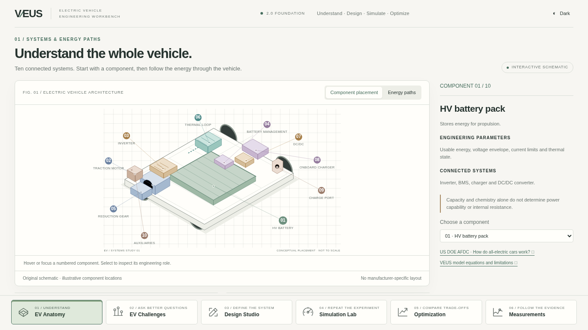
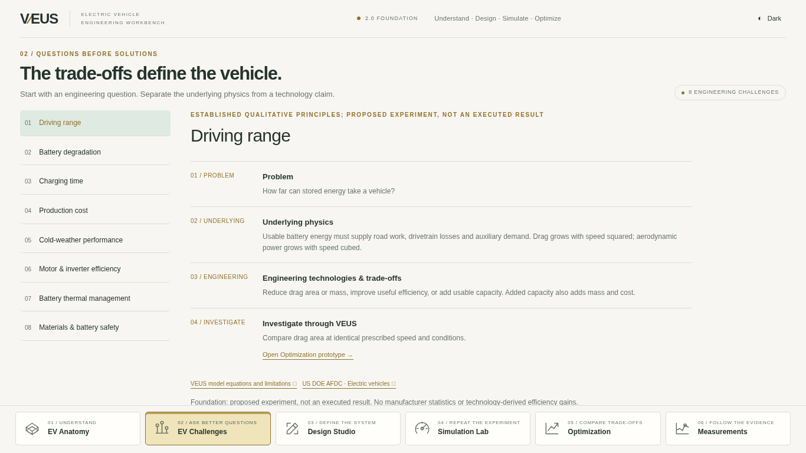
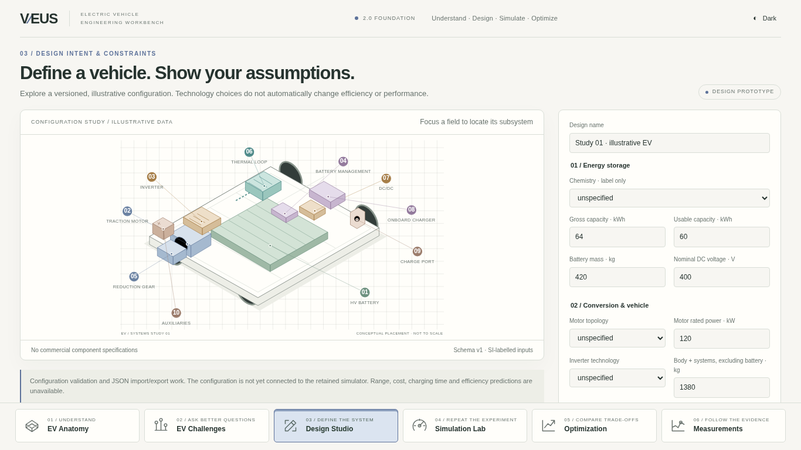
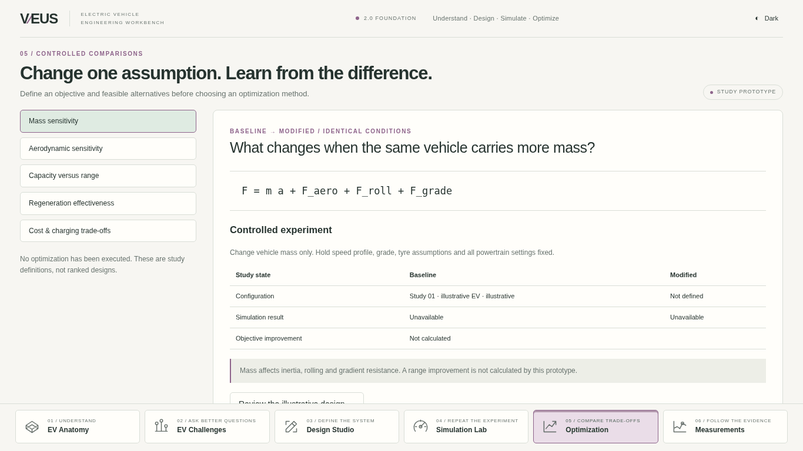
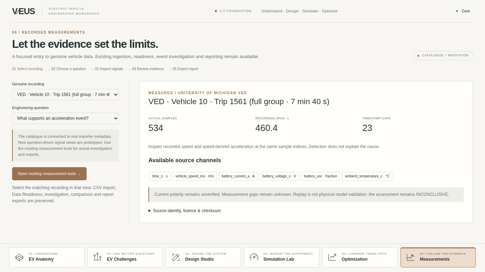

# VEUS — Electric Vehicle Engineering Workbench

**Understand · Design · Simulate · Optimize**

An EV engineering workbench for understanding vehicle systems, making explicit
design assumptions and investigating reproducible experiments and measured evidence.

**VEUS 2.0 Foundation** is a redevelopment milestone, not a stable release. The new
shell is functional; the replacement Simulation Lab, Optimization and question-driven
Measurements interfaces are prototypes. Existing numerical models and engineering
tools remain accessible during migration. No real-vehicle prediction accuracy is claimed.



## Six engineering workspaces

| Workspace          | Available in this foundation                                                                                                                             |
| ------------------ | -------------------------------------------------------------------------------------------------------------------------------------------------------- |
| **EV Anatomy**     | Ten keyboard-accessible components, engineering inspector, EV/combustion comparison and conceptual propulsion/regen/charging/auxiliary energy paths.     |
| **EV Challenges**  | Eight source-referenced engineering questions, underlying physics, technology trade-offs and proposed experiments.                                       |
| **Design Studio**  | Interactive illustrative configuration, typed version 1 schema, envelope checks, JSON import/export. No performance predictions or commercial catalogue. |
| **Simulation Lab** | Instrumentation and experiment-mode prototype; no new-run execution or made-up traces. Retained engineering tools and offline solvers remain available.  |
| **Optimization**   | Controlled study definitions and explicit objectives/constraints; no executed optimizer, improvement scores or cost estimates.                           |
| **Measurements**   | Genuine VED catalogue metadata and question selection; existing import/readiness/investigation/report workflows are linked during migration.             |

Manual keyboard driving, landscapes and ADAS interfaces are retired from the new
primary navigation. They remain isolated in the migration toolset because the
existing replay/calibration frontend still shares their DOM and state dependencies.
No physics/controller changes or useful-test deletions are part of this milestone.

## Run the foundation

Use Python **3.12**. In Windows PowerShell:

```powershell
git clone --branch feature/veus-2.0-engineering-workbench https://github.com/AsherFerdinand/VEUS-ev-testbench.git
cd VEUS-ev-testbench
py -3.12 -m venv venv
.\venv\Scripts\python.exe -m pip install -r requirements-report.txt
.\venv\Scripts\python.exe -m uvicorn veus.studio.main:app --port 8770
```

Open **http://localhost:8770** for EV Anatomy. The bottom navigation supports mouse,
keyboard arrows, Home/End and narrow screens. Theme preference is stored locally.
No new runtime dependencies, account, GPU or large 3D framework are required.

In **Anaconda Prompt**, from the project root on this branch:

```bat
python -m pip install -r requirements-report.txt
python -m uvicorn veus.studio.main:app --port 8770
```

On Linux use `python3.12 -m venv venv` and `venv/bin/python`. The new branch is not
merged into `main`; the archived Phase 11/portfolio implementation is preserved at
`archive/veus-pre-2.0` and its original feature/docs references.

## Existing engineering capabilities

Use **http://localhost:8770/engineering?workspace=analyse** for CSV import, Data
Readiness, replay, event evidence, calibration, comparison and reports. Select
**Simulation Lab → Open existing engineering tools** for the retained simulation
interface. Old endpoints and source evidence remain intact.

```bash
python -m veus.testing physics --output reports/physics-new
python -m veus.testing run scenarios --output reports/scenarios-new
python -m veus.investigation --first ved-10-1561-full --second ved-10-1567-full --output reports/ved-case-new
```

Use new output directories. Some scenario examples intentionally fail their declared
criteria; a recorded failure is not an implementation-test failure or a safety claim.

The genuine VED recordings still contain **534 samples / 460.4 s** and **367 samples /
370.3 s**. Gaps are preserved, known-segment distance is not whole-trip distance, and
unknown current polarity prevents energy-direction/regeneration claims. Replay does
not establish physical model validation; the Phase 8 assessment remains **INCONCLUSIVE**.

## Foundation review and evidence

- [Architecture audit and retain/refactor/retire/remove matrix](docs/veus2/audit.md)
- [New architecture, route contracts and design limitations](docs/veus2/architecture.md)
- [Redevelopment roadmap and unresolved engineering dependencies](docs/veus2/roadmap.md)
- [Engineering content and source-review scope](docs/veus2/sources.md)
- [All six workspace screenshots, light/dark views, tests and measurements](docs/veus2/evidence/README.md)

<details>
<summary>Explore the workspace concepts</summary>







</details>

## Engineering documentation

[Model equations](docs/engineering.md) · [Analytical/scenario verification](docs/validation.md) ·
[Virtual sensor evidence](docs/phase7-evidence/README.md) · [Physical-validation limits](docs/vehicle-validation.md) ·
[Measurement readiness](docs/data-readiness.md) · [Investigation and case study](docs/real-world-investigation.md) ·
[Phase 11 evidence](docs/phase11-evidence/README.md) · [Historical implementation reference](docs/engineering-reference.md)

VEUS uses simplified, uncalibrated models. The foundation does not implement thermal
prediction, ageing, charging curves, commercial pricing, track dynamics or Pareto
optimization. It is an educational engineering workbench, not a production ADAS
system or a safety certification tool.
