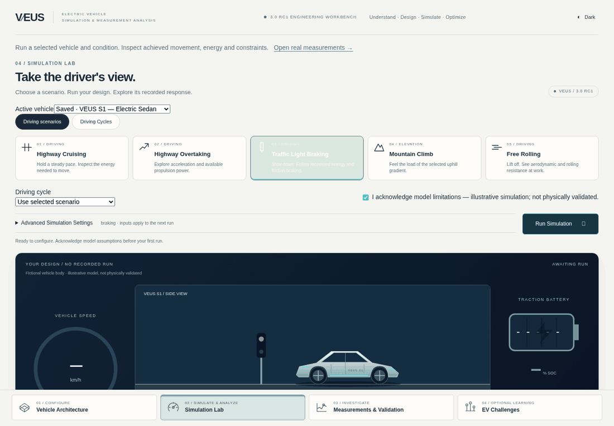
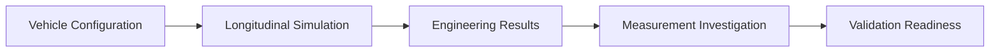
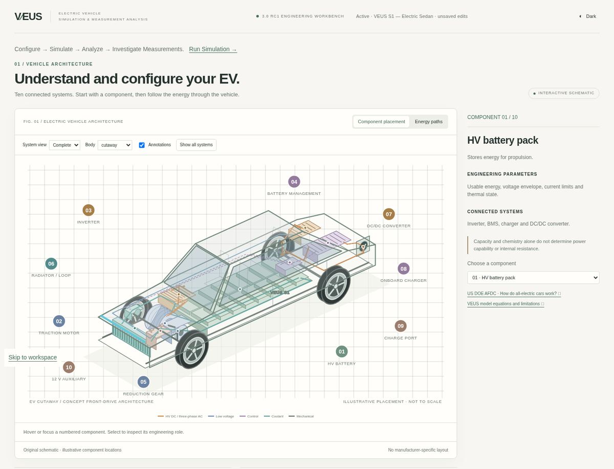
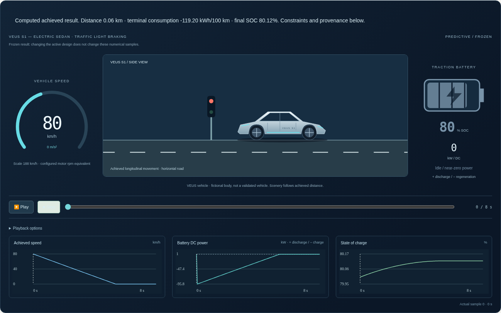
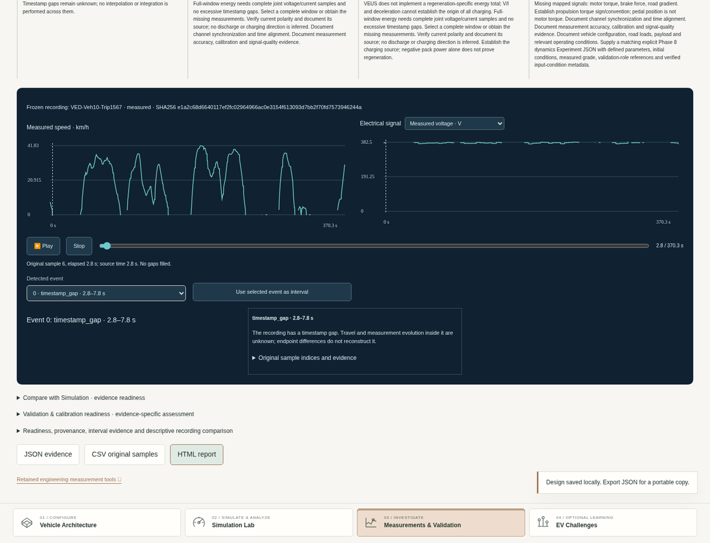
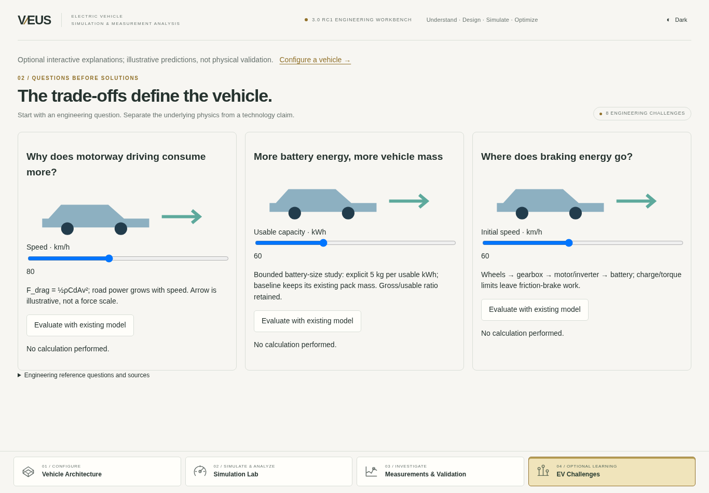
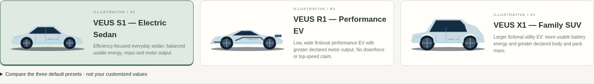
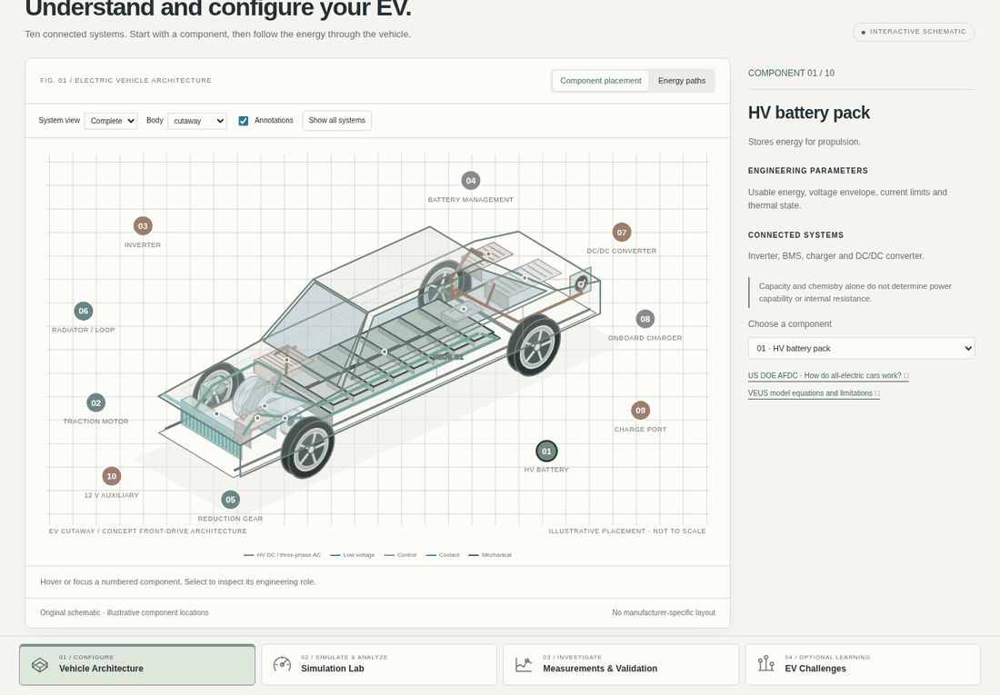
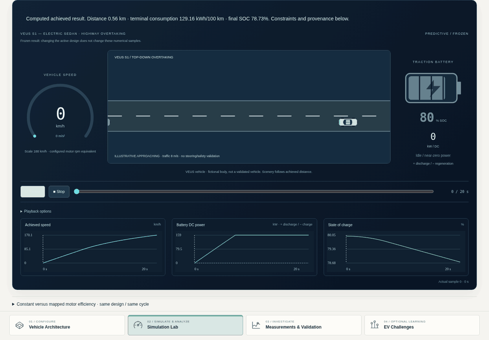
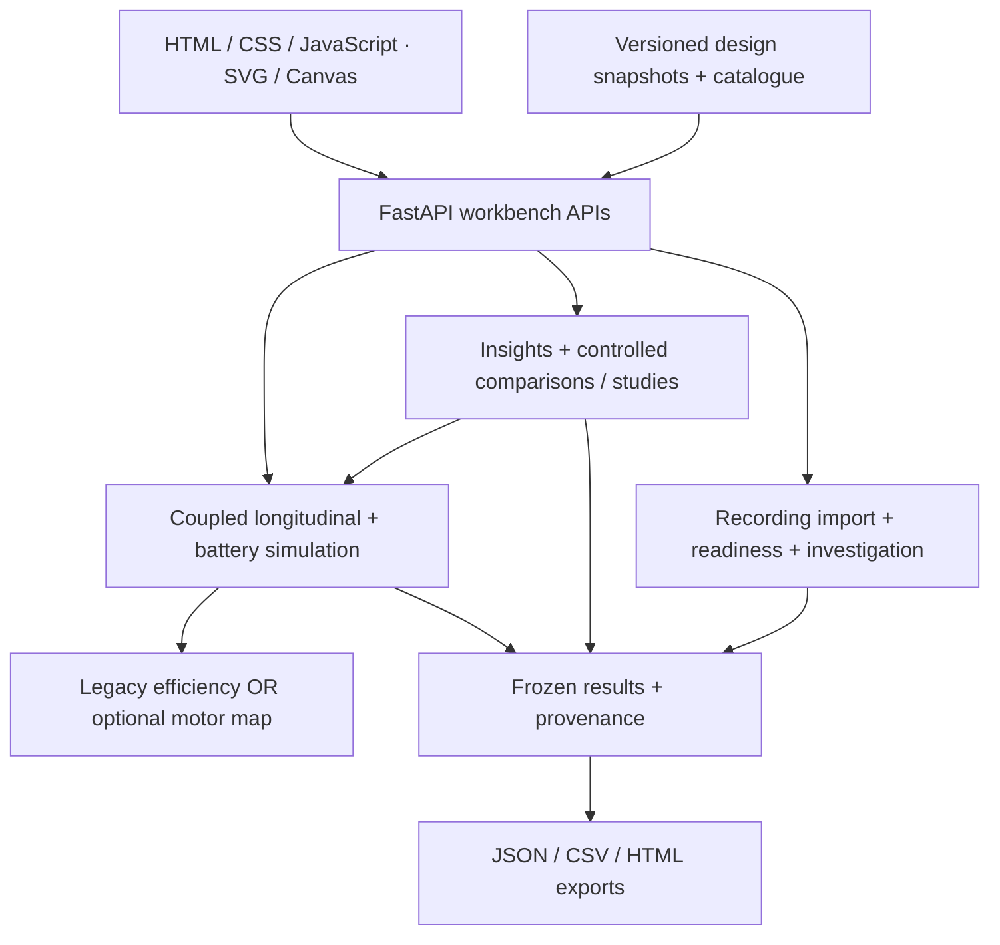

# VEUS — Electric Vehicle Simulation & Measurement Analysis

_A Python-based engineering workbench for EV longitudinal simulation, powertrain analysis and real-world measurement investigation._


Configure an illustrative EV, run a specified driving condition, investigate its energy
and performance, then inspect what independently recorded telemetry can support.
VEUS demonstrates skills in **vehicle simulation, EV powertrain development, model-based
engineering and testing/validation**. Physical validation remains **INCONCLUSIVE**.



_Running application, captured in Chromium: side-view braking replay at 0.5× speed.
No telemetry or vehicle motion was fabricated for the animation._

## What VEUS does



Choose **S1, R1 or X1**, set explicit assumptions and run a scenario or driving cycle.
Inspect achieved speed/acceleration, SOC, electrical power, consumption and constraints.
Compare configurations or loss models, then examine actual recorded signals and events.
[Follow the three-minute engineering demonstration](docs/refocus/workflow.md).

Vehicle JSON preserves a reproducible **model configuration**; the Lab receives it
automatically. Result exports freeze configurations, model assumptions and hashes.
Measurement files are separate evidence: a recorded Nissan Leaf is **not automatically
an S1/R1/X1**, and quantitative validation requires verified compatible inputs.

## Four workspaces

| Vehicle Architecture                                                                                                                                  | Simulation Lab                                                                                                                                        |
| ----------------------------------------------------------------------------------------------------------------------------------------------------- | ----------------------------------------------------------------------------------------------------------------------------------------------------- |
|                                                        |                                               |
| Inspect components and energy paths; select an EV and configure basic parameters. Detailed limits and analysis remain expandable.                     | Run cruising, overtaking, braking, climbing, coasting or driving cycles. Inspect requested versus achieved behaviour and replay synchronized results. |
| **Measurements & Validation**                                                                                                                         | **EV Challenges**                                                                                                                                     |
|                                                    |                                      |
| Select or import data, preview available signals, review mappings, investigate events and export reports. Missing validation evidence stays explicit. | Optional bounded examples explain aero/speed, battery capacity/mass and regeneration using existing Python models.                                    |

### One configuration, three illustrative EVs



| Preset                  | Usable battery | Continuous / peak motor | Total model mass |
| ----------------------- | -------------: | ----------------------: | ---------------: |
| **S1 · Electric Sedan** |         60 kWh |            145 / 180 kW |         1,750 kg |
| **R1 · Performance EV** |         90 kWh |            300 / 450 kW |         1,950 kg |
| **X1 · Family SUV**     |        100 kWh |            180 / 250 kW |         2,450 kg |

These are fictional engineering configurations, not manufacturer specifications. Preset
selection updates one active state; unsaved edits are protected and saved records remain
intact. Configuration JSON is an optional backup, not a required workspace transfer.

<details>
<summary>Watch component selection and S1/R1/X1 configuration changes</summary>



_Actual UI selections and scrolling between the shared cutaway and configuration section._

</details>

## Engineering capabilities

- **Coupled longitudinal experiments:** acceleration, cruise, gradient, coasting and
  braking/regen, with battery SOC/current and drivetrain operating constraints.
- **Driving cycles and routes:** illustrative urban/highway profiles, pinned FASTSim
  UDDS/HWFET cycles and bounded CSV imports with explicit units, gaps and grade policies.
- **Powertrain analysis:** legacy constant efficiency or an explicitly selected illustrative
  RPM/torque map, supported operating region and separate motor/inverter/gearbox losses.
- **Controlled studies:** matched design comparisons, bounded sensitivity and explicit
  battery-capacity/mass trade-offs; continuous ratings remain distinct from peak limits.
- **Measured-data investigation:** genuine VED provenance, original signal/sample references,
  shared cursors, events, quality/readiness gates and JSON/CSV/HTML engineering reports.
- **Deterministic replay:** side views and a top-down overtaking illustration reconstruct
  from stored longitudinal time/distance; pause, seek, rates and reduced motion are supported.

<details>
<summary>Watch the complete top-down overtaking replay</summary>



_Actual playback at 2×: traffic has its own longitudinal position. Lateral motion is
illustrative choreography, not a steering model or collision-avoidance validation._

</details>

## Example: the effect of a different loss model

The verified **S1 / 120 s illustrative urban cycle** uses a 0.2 s step, 0.861 km achieved
distance, 60 kWh usable capacity and continuous ratings. Vehicle and cycle are identical:

| Model-derived quantity                | Legacy constant efficiency | Illustrative motor map |
| ------------------------------------- | -------------------------: | ---------------------: |
| Stored-energy consumption, kWh/100 km |                    11.1893 |                12.8316 |
| Cycle-equivalent range, km            |                     536.22 |                 467.59 |
| 0–100 km/h tick time, s               |                        8.8 |                    8.8 |
| Cycle conversion losses, kWh          |                   0.039060 |               0.053015 |

This demonstrates the effect of **different loss assumptions**, not a measured vehicle
improvement or evidence that one model is more accurate. Range extrapolates this cycle;
it is not certified range or remaining range at the current SOC.
[Verified request, configuration/run hashes and results](docs/veus2/evidence-2.6/model-comparison-summary.json).

## Technical architecture



Python owns engineering calculations. The frontend configures experiments and replays
stored samples. Original datasets and measurement gates remain separate from illustrative
vehicle predictions. [Architecture details](docs/veus2/architecture.md) · [Repository map](docs/REPO_MAP.md).

## Technology stack

| Responsibility          | Technologies actually used                                                                              |
| ----------------------- | ------------------------------------------------------------------------------------------------------- |
| Simulation and services | Python 3.12, FastAPI, Uvicorn; shared vehicle, motor, transmission and battery models                   |
| Numerical/data tooling  | Python SI calculations, CSV/JSON processing, NumPy and Matplotlib for scientific/report tooling         |
| Frontend and replay     | Native HTML/CSS/JavaScript modules, original SVG vehicles, Canvas plots, shared playback clock          |
| Verification            | pytest, analytical/reference cases, Node clock/scene tests, optional Playwright/Chromium browser suites |
| Reproducibility         | Versioned schemas, frozen snapshots, SHA-256 provenance and JSON/CSV/HTML exports                       |

No frontend build, heavy UI framework, game engine or GPU is required. Documentation GIFs
use existing browser capture and Pillow tooling; they add **no application dependency**.

## Quick Start — Windows PowerShell

Use **Python 3.12** and Git:

```powershell
git clone --branch main https://github.com/AsherFerdinand/VEUS-ev-testbench.git
Set-Location VEUS-ev-testbench
py -3.12 -m venv .venv
.\.venv\Scripts\python.exe -m pip install -r requirements-report.txt
.\.venv\Scripts\python.exe -m uvicorn veus.studio.main:app --port 8770
```

Keep that terminal running. Open **http://localhost:8770**, or in a second PowerShell window:

```powershell
Start-Process 'http://localhost:8770'
```

No activation script, administrator rights, WSL or Docker is assumed.
[Detailed Windows/Anaconda instructions and troubleshooting](docs/windows-installation.md).
Commands match the repository; **a clean Windows installation has not been executed**.

## Testing and reproducibility

```powershell
.\.venv\Scripts\python.exe -m pip install -r requirements-dev.txt
.\.venv\Scripts\python.exe -m pytest -q
```

Optional Node checks:

```powershell
node --test tests/browser/replay-controller.test.cjs tests/browser/driving-scene-state.test.mjs
```

Recent verified evidence covers **314 Python cases, 9 clock tests, 8 scene tests and
11 browser suites**, including historical numerical/export fingerprints, saved designs,
profile/route imports and exact legacy measurement JSON/CSV/HTML parity.
[Exact run scope, branding-only rerun and performance evidence](docs/refocus/evidence/verification.json).
This documentation publication reuses that evidence because application behaviour is unchanged.

Results retain supported model versions, units, snapshots, hashes and assumptions.
The library holds up to **16 designs / 180 KB** in the current browser/origin; export
configuration JSON before moving PCs or ports. Original recorded gaps remain unfilled.
[Media provenance and publication checks](docs/media/README.md).

## Model assumptions and validation limitations

Presets and efficiency maps are **illustrative**. Models cover longitudinal movement
and simplified battery OCV/resistance; thermal, ageing, auxiliary, charging-curve and
lateral vehicle dynamics are outside scope. SOH alone cannot determine voltage,
resistance or battery power capability. Peak ratings do not imply sustained peak operation.

Available VED data lack an independently matched complete vehicle configuration,
verified current polarity, synchronization and uncertainty evidence. Consequently,
quantitative model correlation/calibration can remain unavailable, with null residuals
and **INCONCLUSIVE physical validation**. Recorded measurements, simulation predictions
and validated conclusions are distinct. VEUS is not a physically validated digital twin,
production ADAS system or safety certification tool.

## Documentation and project status

The engineering-refocused application is published on **main** for portfolio review.
Application metadata remains **3.0.0rc1**; this publication creates no GitHub Release or
tag and makes no production-readiness or physical-validation claim.

- [Three-minute workflow and measurement-defect analysis](docs/refocus/workflow.md)
- [Design contracts, units and mass accounting](docs/veus2/design-engineering.md)
- [Simulation Lab](docs/veus2/simulation-lab.md) · [Profiles/routes](docs/veus2/profiles-routes.md)
- [Powertrain equations/map boundaries](docs/veus2/powertrain2.6.md)
- [Engineering analysis](docs/veus2/engineering-analysis.md) · [Measurement parity](docs/veus2/measurement-migration.md)
- [Source recording provenance](datasets/ved/README.md) · [Validation/driving limits](docs/veus2/validation-driving2.6.md)
- [Release-readiness limitations](docs/veus3/release-readiness.md) · [Current checkpoint](docs/PROGRESS.md)

The retained historical toolset remains at `/engineering`; its routes and evidence are
preserved outside the four primary workspaces.

**Licence status:** no root project licence has been selected. This repository must not
be represented as openly licensed without an owner decision. VED and FASTSim-derived
materials retain their upstream licences/notices under `datasets/`; these do not license
the whole application. [Licensing review](docs/veus3/release-readiness.md#licensing-and-third-party-materials).
