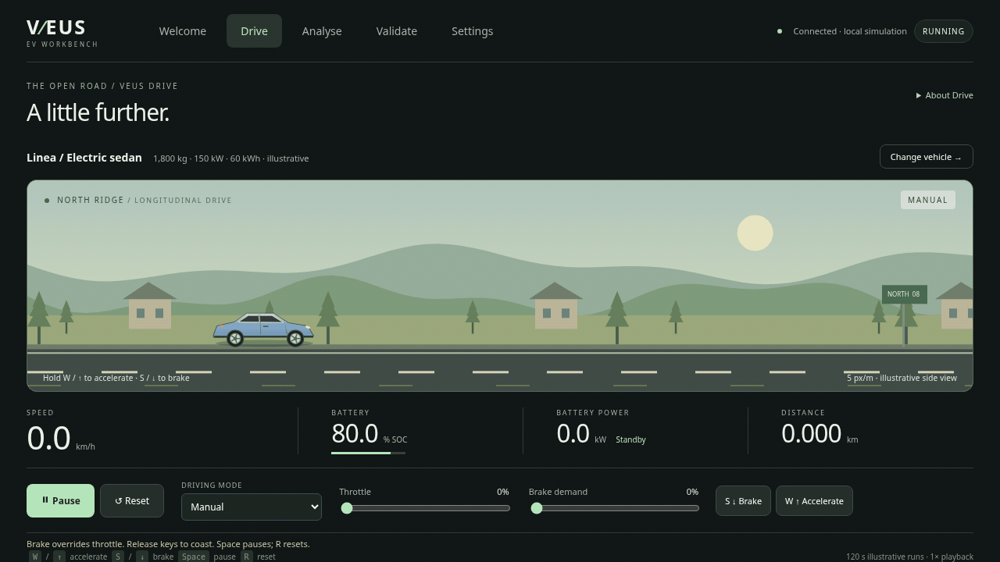
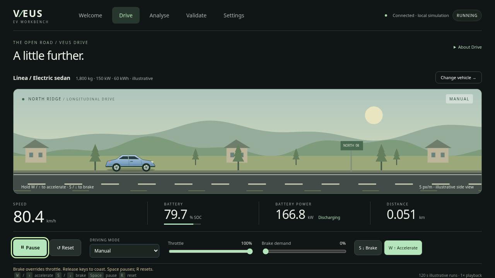
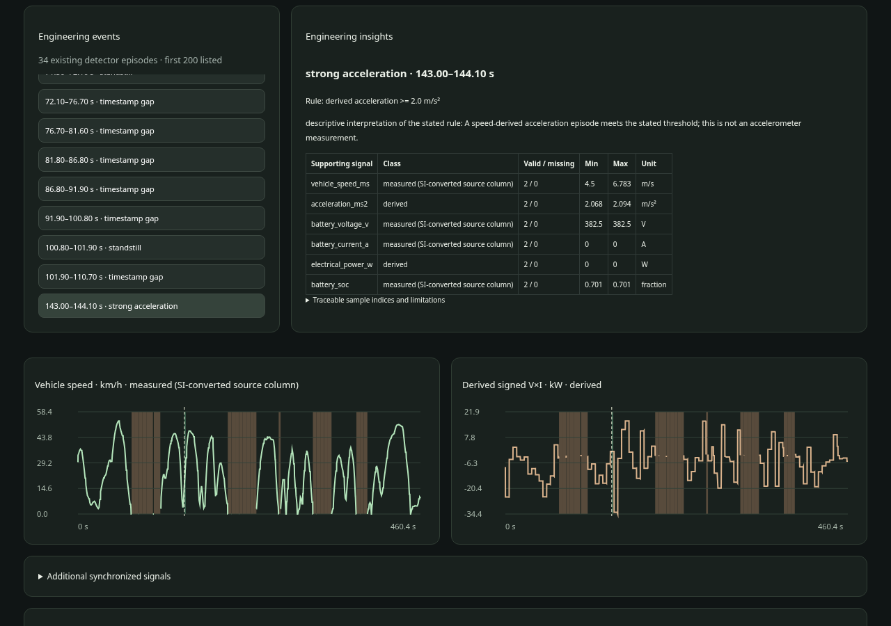
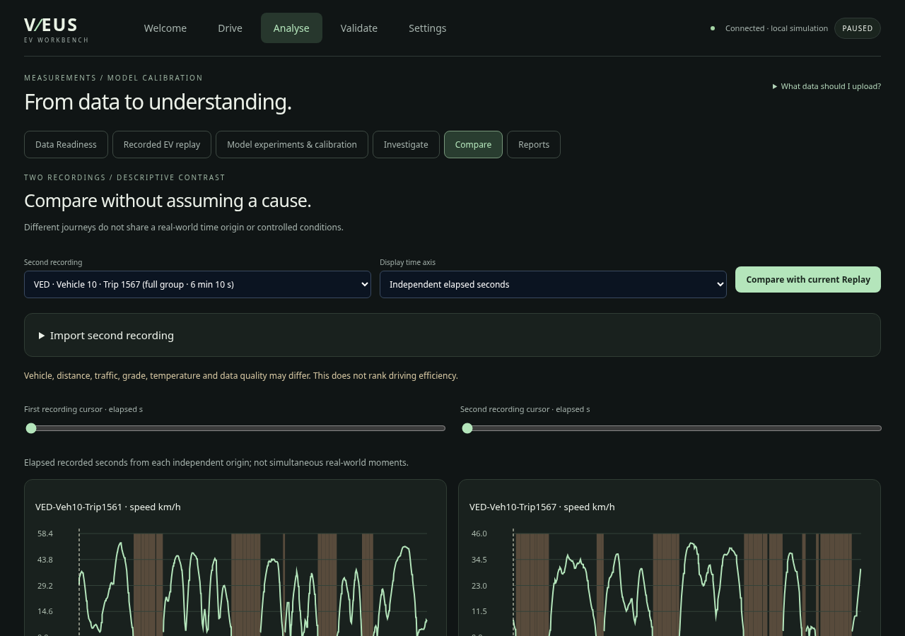
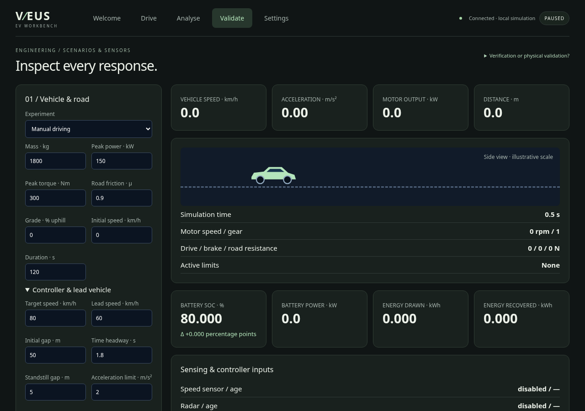
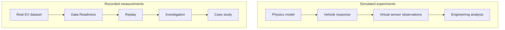

<h1 align="center">VEUS</h1>
<p align="center"><strong>Virtual Electric Vehicle Engineering &amp; Simulation</strong></p>
<p align="center">An interactive EV engineering testbench combining vehicle dynamics,<br>ADAS simulation, real-world telemetry and engineering investigation.</p>

<p align="center">
  <a href="#quick-start"></a>
  <a href="veus/studio/main.py"></a>
  <a href="requirements-report.txt"></a>
  <a href="requirements-report.txt"></a>
  <a href="#verification-and-limits"></a>
</p>

[](#explore-veus)

VEUS is a Python application for exploring how an electric vehicle moves, how its
battery responds, and what recorded vehicle data can actually tell us. Drive an
illustrative EV, investigate genuine measurements, or run reproducible engineering
tests—three workflows with explicit evidence and limitations.

<p align="center">
  <a href="#explore-veus">Explore</a> ·
  <a href="#engineering-workflows">Workflows</a> ·
  <a href="#from-vehicle-data-to-engineering-insight">Case study</a> ·
  <a href="#quick-start">Run locally</a> ·
  <a href="#documentation">Documentation</a>
</p>

## Explore VEUS

| Workspace                 | The question it helps answer                                                | What you get                                                                    |
| ------------------------- | --------------------------------------------------------------------------- | ------------------------------------------------------------------------------- |
| **Drive · Simulate**      | How do driving commands and model settings affect an EV?                    | Interactive driving, battery measurements and driver-assistance behaviour.      |
| **Analyse · Investigate** | What happened in a recorded journey, and what supports that interpretation? | Telemetry replay, event evidence, journey comparisons and case studies.         |
| **Validate · Verify**     | Does the implementation satisfy its equations and declared test criteria?   | Analytical checks, scenario metrics, fault experiments and engineering reports. |

### Drive — Simulate

Accelerate, coast and brake in a 2D driving scene. Explore longitudinal dynamics,
aerodynamic drag, rolling resistance, road gradients, battery SOC and regenerative
brake blending. Try Cruise Control, Adaptive Cruise Control (ACC) and Automatic
Emergency Braking (AEB); inspect virtual sensors and injected faults in Validate.

[](docs/assets/readme/drive-overview.png)

No external data or vehicle hardware is required. Presets are illustrative,
uncalibrated configurations; this is longitudinal simulation, without steering,
lateral dynamics or suspension. [Driving controls and model details →](docs/drive-experience.md)

### Analyse — Investigate

Replay genuine EV recordings with synchronized measurements and a shared cursor.
Inspect acceleration, deceleration, standstill and data-quality events; compare two
recordings and export HTML, JSON and CSV engineering case studies. Available
signals and confirmed mappings determine which calculations are supported.

[](docs/assets/readme/investigate-overview.png)

<details>
<summary>See the two-recording comparison</summary>

[](docs/assets/readme/compare-overview.png)

Separate journeys have independent time origins. Normalized elapsed time is an
optional display transformation, not evidence of matching conditions or efficiency.

</details>

[Replay guide](docs/real-world-replay.md) · [Data Readiness](docs/data-readiness.md) · [Investigation guide](docs/real-world-investigation.md)

### Validate — Verify

Inspect model settings, simulated response and sensor faults. Run analytical
physics checks and configurable ADAS scenarios through the CLI, with quantitative
criteria and portable reports. Model calibration, residuals and measured-data
comparison are available under Analyse → Model experiments & calibration.

[](docs/assets/readme/validate-overview.png)

**Analytical and software verification do not establish real-vehicle prediction
accuracy. Physical model validation remains INCONCLUSIVE.**

[Verification and scenario reports](docs/validation.md) · [Calibration and physical-validation limits](docs/vehicle-validation.md)

## Engineering Workflows



These are separate evidence paths. Replaying measured telemetry does not validate
the physics model; suitable independent inputs, conditions and reference evidence
are still required for physical validation.

## Genuine EV Data

VEUS bundles small, licensed projections of the University of Michigan
[Vehicle Energy Dataset (VED)](https://github.com/gsoh/VED), including vehicle 10,
identified upstream as a **2013 Nissan Leaf**. The replay illustration is generic.

| Phase 11 example | Recorded samples | Recording span |
| ---------------- | ---------------: | -------------: |
| Trip 1561        |              534 |        460.4 s |
| Trip 1567        |              367 |        370.3 s |

Signals include timestamps, speed, battery voltage, signed current, SOC and ambient
temperature. Both recordings contain measurement gaps. Known-segment distance is
**not whole-trip distance**, and unverified current polarity prevents charging,
discharging or regenerative-energy claims from the source sign. Ambient temperature
is not pack temperature.

[Provenance, licence and extraction](datasets/ved/README.md) · [Investigation methods](docs/real-world-investigation.md) · [Phase 11 evidence](docs/phase11-evidence/README.md)

## From Vehicle Data to Engineering Insight

**Trip 1561 · 143.0–144.1 seconds · original sample indices 169–170**

| Evidence           | What the available samples show                                                                                                                          |
| ------------------ | -------------------------------------------------------------------------------------------------------------------------------------------------------- |
| **Measured**       | Speed rises from approximately **4.50 to 6.78 m/s**. Battery current is **0 A** at both supporting samples.                                              |
| **Derived**        | Acceleration exceeds the **2 m/s²** event threshold. Calculated electrical power is **0 W** at both samples.                                             |
| **Interpretation** | A speed-derived acceleration episode is detected. The data does **not** establish its physical explanation or an increase in electrical-power magnitude. |

This is the purpose of VEUS investigation: make the evidence inspectable, and keep
an unknown cause unknown. Two zero-valued current samples do not establish zero
true energy use throughout the interval.

[Open the checked-in HTML report](docs/phase11-evidence/case-study/report.html) ·
[Source hashes, selected events, reproduction and report screenshot](docs/phase11-evidence/README.md)

GitHub shows HTML as source; download the repository and open the report locally
for its rendered plots. The selected event is shown in the Investigate screenshot above.

## Technology

| Layer                         | Tools used                                                              |
| ----------------------------- | ----------------------------------------------------------------------- |
| Backend                       | Python · FastAPI · WebSockets                                           |
| Scientific analysis & reports | NumPy · Matplotlib                                                      |
| Interface                     | HTML · CSS · JavaScript · Canvas; no frontend framework                 |
| Verification                  | Pytest · Node playback-clock tests · Playwright/Chromium browser checks |

## Quick Start

**Use the Phase 11 branch.** The default branch is `main`; the features shown here
are on `feature/real-world-ev-investigation` and have not been merged into `main`.
Git and **Python 3.12** are required for the tested setup. In Windows **PowerShell**:

```powershell
git clone https://github.com/AsherFerdinand/VEUS-ev-testbench.git
cd VEUS-ev-testbench
git switch feature/real-world-ev-investigation

py -3.12 -m venv venv
.\venv\Scripts\python.exe -m pip install -r requirements-report.txt
.\venv\Scripts\python.exe -m uvicorn veus.studio.main:app --port 8770
```

Open **http://localhost:8770**. Choose **Drive** for an immediate simulation, or
**Analyse → Investigate** to load a bundled VED recording. No account, GPU, external
service or raw dataset download is required. Press `Ctrl+C` in the terminal to stop.

<details>
<summary>Anaconda, Linux and development commands</summary>

In **Anaconda Prompt**, with Python 3.12 selected, run these from the project root
on the Phase 11 branch:

```bat
python -m pip install -r requirements-report.txt
python -m uvicorn veus.studio.main:app --port 8770
```

On Linux, replace the environment creation with `python3.12 -m venv venv` and use
`venv/bin/python` for installation and launch. Activation is optional on both platforms.
For development, install `requirements-dev.txt`; `requirements-lock.txt` records the
pinned tested environment. [Setup, model examples and CLI commands](docs/engineering-reference.md).

</details>

## Verification and Limits

The [recorded Phase 11 verification snapshot](docs/phase11-evidence/README.md)
contains **187 passing Python tests**, **9 passing playback-clock tests** and
**four passing browser regression suites**. These are documented results for that
phase, not an automatically maintained current test count.

- **Software tests** check implementation behaviour, imports, data gates and exports.
- **Analytical verification** compares numerical results with defined equations.
- **Physical validation** requires adequate independent measured reference evidence;
  the existing assessment remains **INCONCLUSIVE**.

Some scenario examples intentionally fail their avoidance/tracking criteria;
reports preserve those failures. Simplified battery and efficiency models,
uncalibrated vehicle presets and incomplete measured operating conditions limit
what can be concluded. VEUS is an educational engineering workbench, not a
production ADAS system or safety certification tool.

[Analytical evidence](docs/verification/README.md) · [Scenario and sensor outcomes](docs/phase7-evidence/README.md) · [Physical-validation assessment](docs/phase8-evidence/README.md)

## Documentation

| Start here                                                                         | Go deeper                                                             |
| ---------------------------------------------------------------------------------- | --------------------------------------------------------------------- |
| [Getting started & workflow guide](docs/user-onboarding.md)                        | [Engineering assumptions & equations](docs/engineering.md)            |
| [Vehicle simulation & driving controls](docs/drive-experience.md)                  | [ADAS scenarios & analytical verification](docs/validation.md)        |
| [Virtual sensors & fault injection](docs/virtual-sensors.md)                       | [Model calibration & physical validation](docs/vehicle-validation.md) |
| [Real-world replay](docs/real-world-replay.md)                                     | [Data Readiness](docs/data-readiness.md)                              |
| [Real-world investigation](docs/real-world-investigation.md)                       | [Phase 11 evidence & case study](docs/phase11-evidence/README.md)     |
| [Preserved implementation & reproduction reference](docs/engineering-reference.md) | [Future battery SOH interface](docs/soh-integration.md)               |

[README media, capture method and presentation checks](docs/assets/readme/README.md)
