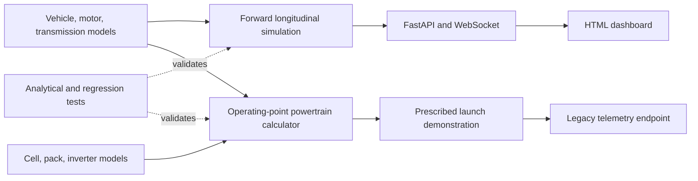

# VEUS — EV Simulation Workbench

VEUS is an educational Python vehicle simulation project. The current version provides a
forward longitudinal dynamics model, reusable EV component calculations,
a constant-OCV battery energy model, regenerative brake blending, analytical
regression tests, and an interactive FastAPI dashboard. Parameters
are illustrative and uncalibrated. This is not a production ADAS or safety tool.

## Run locally

Python 3.12 is validated. From the repository root on Windows:

```powershell
py -3.12 -m venv venv
.\venv\Scripts\python -m pip install -r requirements-dev.txt
.\venv\Scripts\python -m pytest -q
.\venv\Scripts\python test_run.py
.\venv\Scripts\python -m uvicorn veus.studio.main:app --port 8770
```

Open the dashboard at the server's local address on your own machine. On Linux,
create the environment with `python3 -m venv venv` and use `venv/bin/python`.
For the fully pinned tested dependency set, install `requirements-lock.txt`.
No GPU, external service, credentials, or vehicle hardware is required.

## Two simulation workflows

`VehiclePowertrain.solve_point()` calculates required powertrain demand for a
specified speed, acceleration and SOC. `test_run.py` demonstrates this inverse
calculation. It does not predict achieved acceleration.

`LongitudinalSimulator.step()` predicts motion from motor torque and friction
brake commands. It reuses the vehicle, motor and transmission models, applies
motor and road traction limits, and integrates speed and position.

```python
from veus.sim.dynamics import LongitudinalSimulator, VehicleState

sim = LongitudinalSimulator()
state = VehicleState()
for _ in range(100):
    result = sim.step(state, motor_torque_nm=300, brake_force_n=0, dt_s=0.01)
    state = result.state
print(state)
```

The dashboard now runs the forward mechanical simulation. Select manual driving,
full-throttle acceleration, braking from 80 km/h, or coast-down. Set mass, motor
power/torque, friction, road gradient, starting speed and duration; click **Apply &
reset**, then **Run**. In manual mode, adjust throttle and brake live. Brake
commands override throttle. Pause/resume retains state; reset starts a new run.
Plots show speed, acceleration, mechanical motor power and torque. CSV and JSON
metadata exports are available. Use 0.9 versus 0.1 friction to compare braking,
or change vehicle mass to compare acceleration. Defaults represent an illustrative
1,800 kg / 150 kW / 300 Nm EV, not a calibrated production vehicle.

Each browser tab owns an independent simulation, with 0.01 s physics steps and
0.1 s telemetry frames at nominal 1× playback. Slow networks can slow playback;
simulation time is authoritative. Runs stop after 1–120 s. Closing the tab loses
server state; export results before reloading. Live pedal-command history is not
recorded, so exported manual runs are not yet fully replayable. Battery energy, SOC, charge/discharge limits and regenerative brake blending are
implemented. ADAS and engineering acceptance reports remain future work.

The old prescribed launch is retained at `/ws/telemetry` for compatibility;
the dashboard uses `/ws/simulation`. The old launch has fixed SOC and is a
repeating demonstration, not the new interactive simulation.

## Architecture



See [engineering assumptions and validation](docs/engineering.md) for equations,
limitations, test evidence and the remaining roadmap.


## Battery and energy experiments (Phase 2)

Expand **Battery & energy settings**, edit capacity/initial SOC/current limits and
regeneration settings, then **Apply & reset**. Battery power is positive during
discharge and negative during charging. Compare braking from 80 km/h with regen
on/off, or with initial SOC=1: friction brakes preserve stopping demand when the
pack cannot accept charge. An initial SOC of zero disables powered acceleration.
Lower the discharge-current limit to see battery-limited acceleration.

The dashboard shows SOC, terminal voltage/current/power, consumed and recovered
energy, regenerative/friction brake force, and an energy-accounting residual.
CSV exports include cumulative battery/conversion/braking losses and road work.
The battery uses fixed OCV with resistance, not a detailed chemistry model.
Motor/inverter efficiencies are constant; transmission efficiency is applied
separately in both directions. No auxiliary loads, thermal dynamics or ADAS yet.


### Inspecting small SOC changes

The SOC plot spans the available width and automatically zooms its vertical axis
around the measured SOC, with three-decimal tick labels. It is explicitly not a
zero-based axis. The SOC card reports change from run start in percentage points,
so a rise from 80.000% to 80.072% is shown as +0.072 percentage points. Each chart
has an **Expand** button for a large dialog view; use **Close graph** or Escape
to return. Physics and recorded telemetry are unchanged by display zoom.
