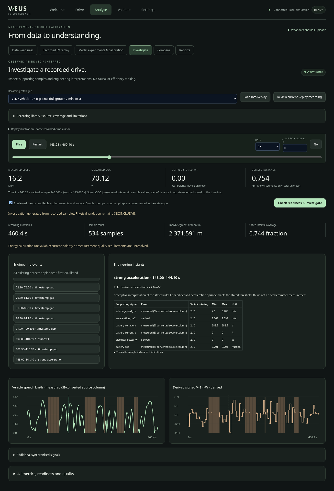
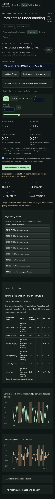
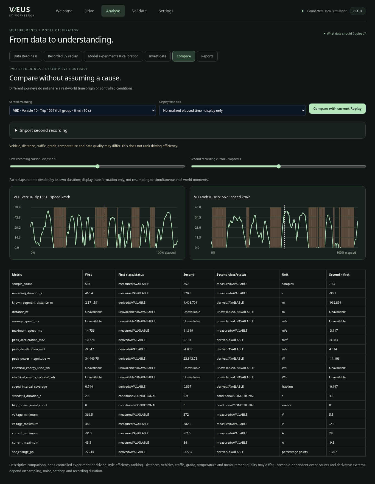
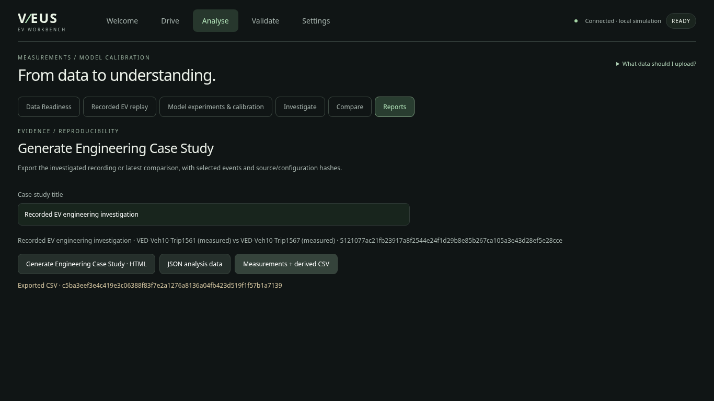
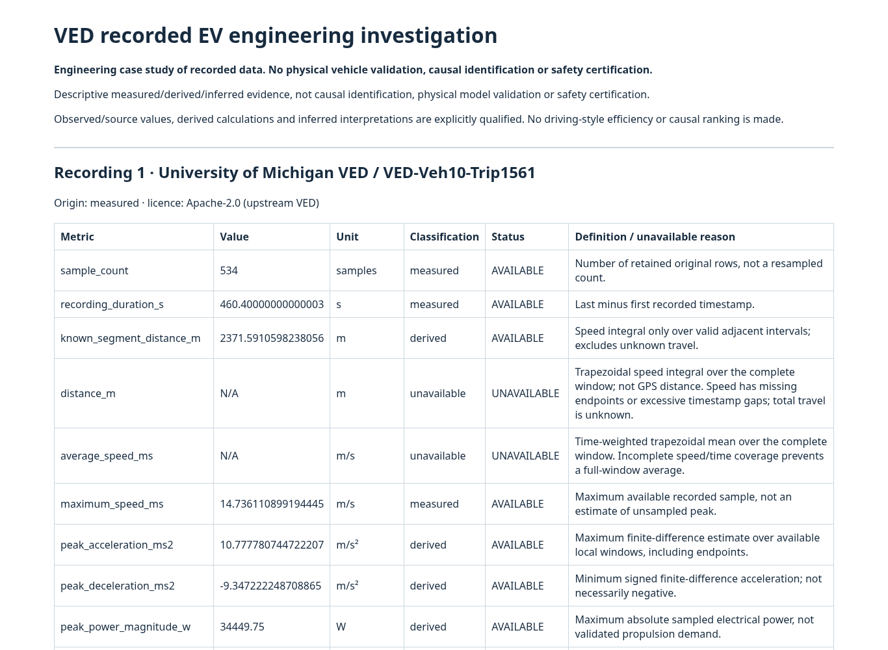

# Phase 11 executed evidence

This evidence describes measured VED recordings and software verification.
It does not change Phase 8's **INCONCLUSIVE** physical-validation finding.
The [implementation plan](../phase11-plan.md) preceded the changes; the
[investigation guide](../real-world-investigation.md) documents calculations,
architecture, bounds, source selection and limitations.

## Genuine-data case study

[Portable HTML report](case-study/report.html) · [Canonical JSON](case-study/case-study.json) ·
[Measured and derived CSV](case-study/measurements-derived.csv)

The checked-in case was executed with:

```bash
python -m veus.investigation --first ved-10-1561-full --second ved-10-1567-full --output NEW_CASE_DIRECTORY
```

Case SHA256:
`3740be7a31e9f617fa9e6ae8bd07b0309dd4b25c6304efb6f1048ee275c65a5e`.
The bundle includes unchanged original CSV bytes and both full investigation
configurations. The case uses `veus-investigation-v1`; source hashes, original and
scoped replay fingerprints, readiness, settings, thresholds and Python/library
versions are embedded. A clean-source commit and verification record are in
[execution.json](execution.json). Reproduction with matching dependencies/settings
must produce the same canonical JSON hash; HTML image rendering is environment dependent.

Source: University of Michigan [VED](https://github.com/gsoh/VED), Apache-2.0,
commit `6baa4963782d515a67d32a5490bd5d11f5d9bf0d`, archive member
`VED_171101_week.csv`, vehicle 10, trips 1561 and 1567. Full provenance and exact
source rows/timestamps/hashes are in
[full-recordings-provenance.json](../../datasets/ved/full-recordings-provenance.json).
Both source projections were independently reproduced byte for byte by the optional
archive extraction helper. No raw archive is committed. The original short fixtures
are untouched, and full trip 1561 overlaps the original short 1561 window.

| Quantity                                   |   Trip 1561 |   Trip 1567 | Qualification                                |
| ------------------------------------------ | ----------: | ----------: | -------------------------------------------- |
| Rows                                       |         534 |         367 | Actual source rows                           |
| Recording span                             |     460.4 s |     370.3 s | Complete group in inspected archive member   |
| Gaps >2 s                                  |          23 |          34 | Retained, not interpolated for calculations  |
| Valid speed interval duration              |     342.5 s |     221.2 s | 74.3918% / 59.7353% coverage                 |
| Known-segment distance                     | 2371.5911 m | 1408.7005 m | Derived; **not whole-trip distance**         |
| Maximum recorded speed                     |  53.05 km/h |  41.83 km/h | Source speed after unit conversion           |
| Maximum sampled electrical magnitude       | 34.44975 kW | 23.34375 kW | Derived abs(V×I), unknown polarity           |
| Whole-span distance / average speed        | Unavailable | Unavailable | Unknown travel across gaps                   |
| Discharge / received / regenerative energy | Unavailable | Unavailable | Unverified polarity and quality requirements |

Signals include timestamp, speed, voltage, signed current, SOC and outside air
temperature. Air temperature is not pack temperature. Signed power is derived,
acceleration is differentiated speed, and neither is a direct propulsion-force
measurement. The largest derivatives are sampling/noise sensitive; no smoothing,
vehicle calibration or road-load identification is claimed.

### Traceable selected event

Trip 1561, **143.0–144.1 s**, original sample indices **169–170** (zero-based):

- Recorded speed increases from approximately **4.5000 to 6.7833 m/s**.
- Derived acceleration at those samples is approximately **2.0675 and 2.0939 m/s²**,
  satisfying the existing ≥2 m/s² threshold and minimum episode duration 0.5 s.
- Both available voltage samples are **382.5 V**, current samples **0 A** and
  derived power samples **0 W**. No increased-power association is supported here.
- SOC is unchanged at the sampled precision. This is not evidence of efficiency,
  battery health, or zero true energy use throughout the interval.

The defensible finding is a speed-derived acceleration episode. Source current
sampling/synchronization and measurement accuracy are not independently established;
road gradient and auxiliary loads are unknown. The deterministic insight therefore
does not invent an electrical cause. The report also selects a deceleration episode
at 161.3–161.9 s and standstill at 71.5–72.1 s using the documented default selection.
Trip 1567's first qualifying acceleration is 39.6–40.1 s; its available sampled power
is likewise zero at the endpoints. Different recordings do not permit efficiency
ranking, and their elapsed axes do not identify simultaneous moments.

## Browser evidence

Actual headless Chromium runs used four investigation/replay viewports:
1920×1080, 1366×768, 820×1180 and 390×844. The UI was visually inspected at laptop
and mobile size. Browser checks assert shared six-signal cursors, selected-event
sample evidence, independent comparison navigation, normalized display labelling,
CSV/config import of a second recording, all three report downloads, exactly 901
exported source rows, energy gating, restored original Replay controls and Drive
keyboard operation. These cloud checks do not certify Ryzen 5500U laptop performance.







Screenshots show interactive browser state, which may select one event and normalized
comparison time. The CLI case above uses default selected events and elapsed time;
these distinct case settings are retained explicitly rather than claiming identical hashes.

## Automated verification

Historical baseline was rerun before changes: 177 Python tests and 9 clock tests.
Final suite: **187 Python tests pass**; **9 playback-clock tests pass**. Existing
assertions are preserved. Ten new backend tests cover catalogue/provenance, full
recordings, gaps/missing signals, detector reuse and sample traceability, polarity
and readiness gating (including the positive synthetic-policy path), mismatched
readiness evidence, comparisons/overlap, deterministic case hashes, original bytes,
CSV/HTML/API consistency, escaping and body bounds. Synthetic arithmetic fixtures
are explicitly classified synthetic and are never presented as measured evidence.

Executed browser regressions: **Drive PASS, Replay PASS, Guidance PASS,
Investigation PASS**, with no browser page errors. Outputs are preserved alongside
this document. Python lint (`ruff 0.14.3 --select F,E9`) passes for new modules,
extractor and tests. The full coverage run reported 94.24% statement coverage and
84.15% branch coverage (92.03% combined); this is software coverage, not physical
model coverage. CLI/extraction were additionally executed outside pytest.

```bash
python -m pytest -q
node --test tests/browser/replay-controller.test.cjs
# Requires Playwright and a Chromium installation; serve VEUS first.
node tests/browser/drive.cjs
node tests/browser/replay.cjs
node tests/browser/guidance.cjs
node tests/browser/investigation.cjs
```

Optional browser environment variables: `PLAYWRIGHT_MODULE`, `CHROMIUM_PATH`,
`VEUS_URL`, `VEUS_SCREENSHOTS`. No browser tooling is required to use VEUS.

## Local Anaconda launch

From the actual project root (the folder containing `veus`, not its parent):

```bat
python -m pip install -r requirements-report.txt
python -m uvicorn veus.studio.main:app --port 8770
```

Open http://localhost:8770 and select Analyse → Investigate. The checked-in examples
require no archive download. University-PC virtual environments are local to that PC;
use `python` from the current Anaconda Prompt rather than an old machine's venv path.
