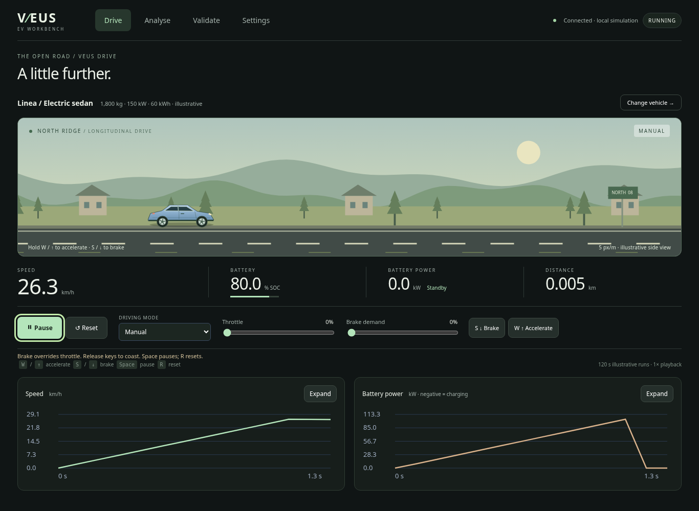
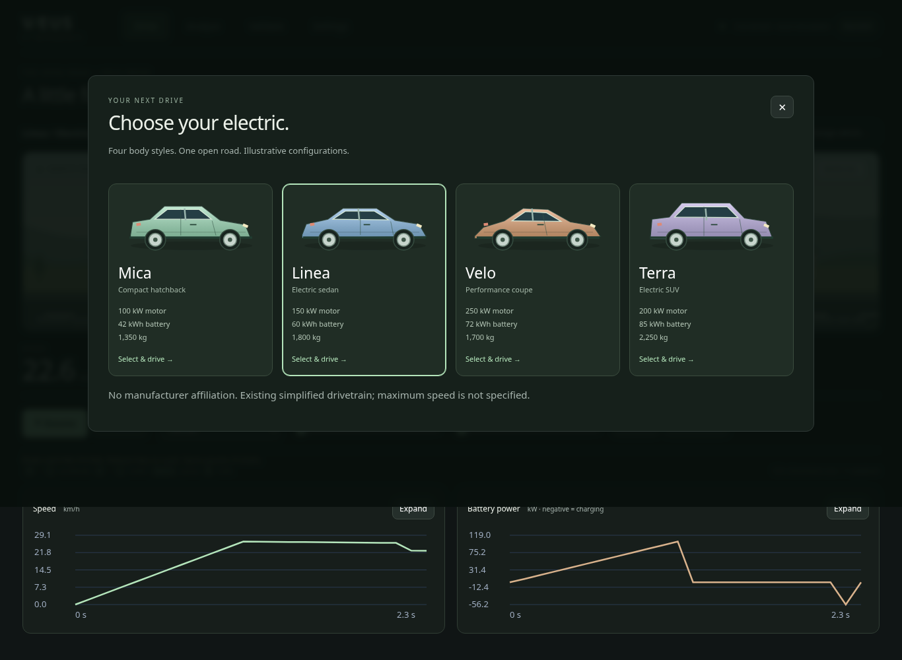

# Phase 9 execution evidence

Implementation: `6089464`. Browser regression and screenshots were captured from
that clean commit. This evidence commit adds artifacts/documentation only.
Python coverage was collected before the implementation commit, against identical
Python source. No physics/controller source or prior scenario criteria changed.

## Results

- **140 Python tests pass**, including the complete original Phase 8 baseline of 134.
- Python coverage: **94.82% statements, 82.58% branches, 92.17% combined**.
  This does not measure JavaScript coverage or physical accuracy.
- All 11 analytical reference traces pass.
- Original ADAS batch remains six PASS/two FAIL (delayed braking and low grip).
- Sensor batch remains four PASS/three FAIL (radar latency, radar positive bias,
  speed-sensor bias). Both batches correctly exit 1, retaining previous failures.
- Changed Python lint, JavaScript syntax, dependency consistency and whitespace
  checks pass. The existing Starlette/httpx test deprecation warning remains.
- Actual Chromium browser regression passes with no JavaScript page errors.

[Python coverage summary](coverage-summary.json) · [Browser observations](browser-results.json)

## Actual browser interactions

The checked-in [regression script](../../tests/browser/drive.cjs) exercises:

- All four vehicle selections and their resolved backend mass/power/capacity.
- Keyboard acceleration, braking, release and simultaneous-key brake priority.
- No key-repeat request flood, release on window blur, typing guards.
- Pause/resume, reset, workspace release/pause and return without page reload.
- Analyse synthetic calibration followed by distinct-run evaluation, both PASS.
- Preserved sensor settings and telemetry export access in Validate.
- Manual/ACC switching, non-null real lead gap and disabled auto-mode pedals.
- Pointer-held brake/release on the mobile layout.
- Stationary/paused road position; interpolation remains bounded by samples and
  does not extrapolate when updates cease. The isolated injected samples are
  explicitly synthetic renderer tests, not measurements or physics results.
- Backend rejection shown in Drive, input release/page-hiding behavior and socket
  closure with disabled controls/unavailable primary readouts.
- No horizontal overflow and visible control bar at 1920×1080, 1366×768,
  820×1180 and 390×844. Laptop controls also remain visible after scrolling.

## Screenshots

These are actual screenshots, not mockups. The driving screenshots use the sedan
preset reset to zero initial speed before acceleration; values reflect live
telemetry. Full-page captures include below-fold charts. On the tested laptop
viewport, the scene, primary telemetry and driving controls are above the fold.

[Mobile Drive screenshot](drive-mobile.png)

## Performance observations and limits

The clean-commit browser run records a mean **16.78 ms** rendered-frame interval
over its last 300 observations, approximately **59.6 frames/s**. This is a short
headless Linux cloud observation, not a guaranteed rate or a benchmark on an
8 GB Windows laptop with integrated graphics. Physical playback remains nominally
1× with the unchanged 0.01 s integration step and approximately 10 Hz telemetry.
No simulation frequency increase was used to produce smooth visuals.

Canvas resolution is capped at 2× CSS resolution; source SVG assets are small.
The frame-time ring is bounded at 300 entries and telemetry at <=120 s per run,
nominally 1201 unique samples. Rendering is canceled for hidden pages, and hidden
charts are skipped. These are structural resource bounds; no extended heap soak
or Windows memory/FPS benchmark was performed. The browser test package is an
optional development tool, not an application dependency.

## Known limitations

Illustrative presets share several model defaults and do not represent calibrated
manufacturer vehicles. Maximum speed/axle topology is unspecified. Scenes have
no steering, lateral dynamics or suspension. Cars are enlarged; reference bumper
separation uses 5 px/m, with off-screen lead distance shown explicitly. Visual
interpolation introduces about one telemetry-update delay and stops at received
samples. Network/server slowdown can reduce apparent playback speed. A dropped
socket requires a reload and fresh session; run exports remain available before
reload. No production safety function or real-world physical validation is claimed.

See [architecture, controls and reproduction](../drive-experience.md) for exact
policies and commands. Optional browser automation requires Playwright/Chromium;
the Python application adds no new runtime dependency in this phase.
