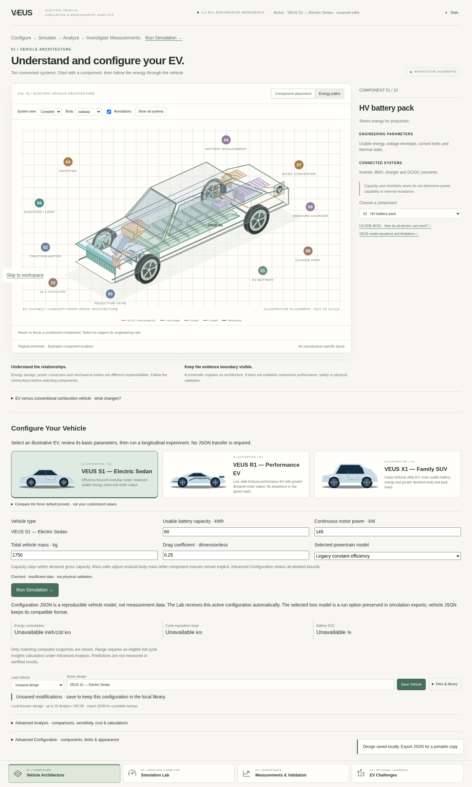
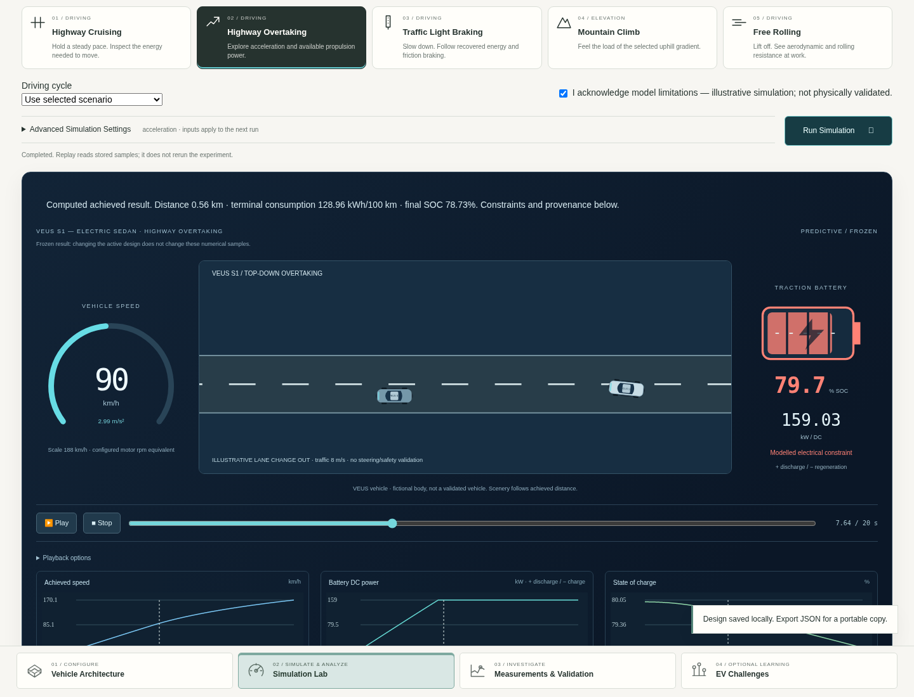
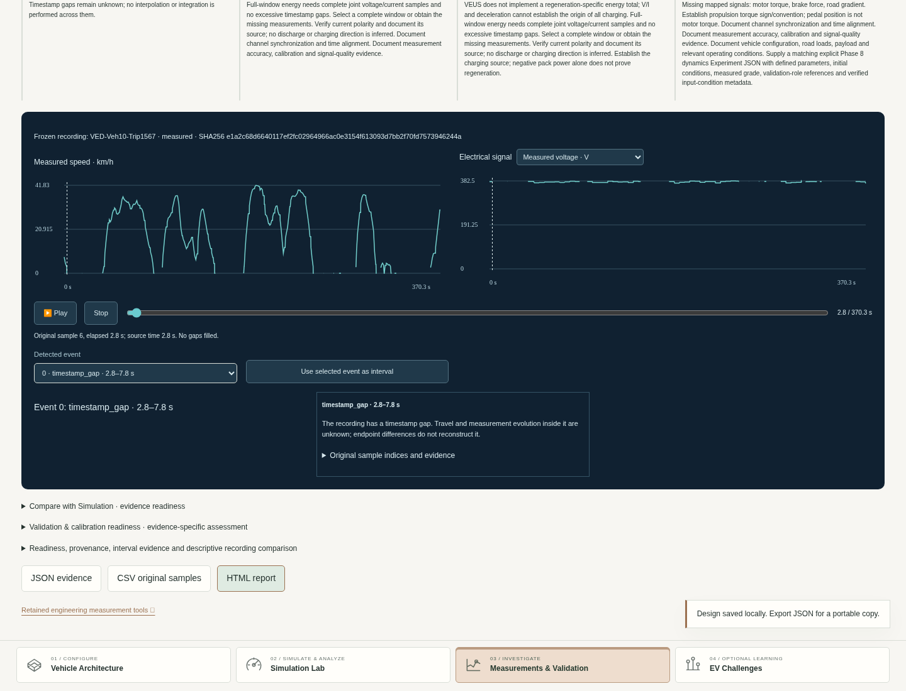

# Engineering refocus evidence

Base `344376e9d4504089124ddd4c1f43acbdaefac799`, feature branch only.
No merge/release, new numerical model, dependency or saved-design schema.

## Verification

[Final verification](verification.json): **314 Python tests, 9 clock tests, 8 scene
tests and 11 browser suites**. The new normal-workflow suite runs without the advanced
test adapter. It covers direct preset selection, saved/draft protection, SPA transfer,
explicit consent, all cameras, urban run/export, matched loss-model comparison,
measurement preview, mapping review, actual events/report, validation gates, HTTP failure
clearing and interactive learning. Existing suites still verify exact historical hashes,
JSON/CSV/HTML parity, saved configurations, custom profiles/routes, reduced motion and
responsive/keyboard interactions. No numerical assertion was relaxed.

Older UI suites explicitly open the relocated advanced controls using a test-only adapter;
tab names/count/order and the former preview/apply expectation follow the new contract.
The generic workbench analytical test now explicitly selects its original backend fixture
so historical mass values remain tested independently of the new first-time S1 default.
Full Python/final applicable browser regression runs once after integration, with focused
UI/numerical checks during development. An existing Starlette/httpx warning remains. The full Python run passed 313 cases and
failed one old title literal; that assertion was updated for the requested project name
and its complete root-isolation/migration test rerun passed. Thus all 314 cases are
verified without repeating the full suite.

The final [cycle-selection race check](cycle-selection-race.json) also verifies that a
pending/failed new cycle cannot execute the previous source. The affected Lab and normal
workflow suites passed targeted reruns after this guard; the full Python suite was not
repeated.

## Actual measurement defect reproduction

[Before/after](measurement-reproduction.json) selects the supported 367-sample VED trip
on the old commit and refocused app. Previously only metadata updated: no plot was
installed before the separate confirmed investigation. New selection calls the existing
replay analyser and shows real channels while mapping consent remains false. It clears
old plots/results/export state, checks HTTP errors and guards late responses. No source
bytes, gaps, backend investigation algorithms or report serializers were changed.

A source-preview is not an authenticated measurement mapping or investigation. The
separate confirmation still controls events/reports; unknown polarity still gates signed
power/energy. Current measured-versus-model status is **INCONCLUSIVE**.

## Essential comparable performance

Same Linux environment and Python interpreter; isolated clean base worktree versus
current tree. Existing tools, four samples with first excluded. Values are small shared-host
observations, not a speedup, clean-Windows or laptop claim. Bytes are decoded response
bodies; RSS is server-process memory, not browser memory.

| Median | Base | Refocused |
| --- | ---: | ---: |
| Initial subresource bodies, B | 100,319 | 272,026 |
| Startup server RSS, KiB | 44,388 | 44,376 |
| Post-evaluation RSS, KiB | 49,920 | 49,936 |
| Startup, s | 0.273 | 0.282 |
| Complete-design evaluation, ms | 1.353 | 1.310 |
| Urban + continuous acceleration Insights, ms | 77.9 | 74.2 |
| Initial browser load incl. network-idle wait, ms | 634 | 691 |
| Browser idle main-thread task fraction, % | 0.083 | 0.098 |
| Selection synchronous handler, ms | 0.6 | 1.0 |

[Server before](performance-before.json) / [after](performance-after.json);
[browser before](browser-before.json) / [after](browser-after.json).
Static browser samples have zero background requests, sockets and pending application
callbacks/frames. Server idle sampled 1% before and 0% after; a one-second CPU tick is
about 1%, so these are sampling noise, not proof of zero CPU or an optimization claim.

Initial bytes grew because configuration moved into the initial Architecture page.
A targeted [combined-workflow footprint audit](combined-footprint.json) investigates this
scope difference: architecture + configuration was **278,786 B before / 272,026 B after**;
including all advanced analysis is **278,786 B / 290,942 B** (~4.4% growth). Calculation
modules remain lazy until Advanced Analysis opens. This audit measures resource bodies,
not repeated runtime samples; it avoids presenting different page responsibilities as a
performance regression or speedup. No heavy framework, rendering engine or dependency.

## Three genuine captures







Captured from the real application with Chromium. Road/lateral choreography is illustrative;
longitudinal traces and recorded signals are genuine outputs of their stated sources.

## Reproduce

```bash
python -m pytest -q
node --test tests/browser/replay-controller.test.cjs tests/browser/driving-scene-state.test.mjs
```

Browser suites: modern `workbench`, `vehicle-classes`, `lab`, `engineering-workflow`,
`advanced`, `release`, `refocus`; retained `drive`, `replay`, `guidance`, `investigation`.
Use the usual optional PLAYWRIGHT_MODULE/CHROMIUM_PATH and VEUS_URL variables; retained
suites use `/engineering`. Set VEUS_CAPTURE=0 except the final refocus capture run.
The screenshot run writes exactly these three PNGs; raw exports/tool logs stay outside Git.
[Workflow and limitations](../workflow.md). Windows and non-Chromium browsers are unverified;
root project licensing still requires the owner decision recorded in the release checklist.
