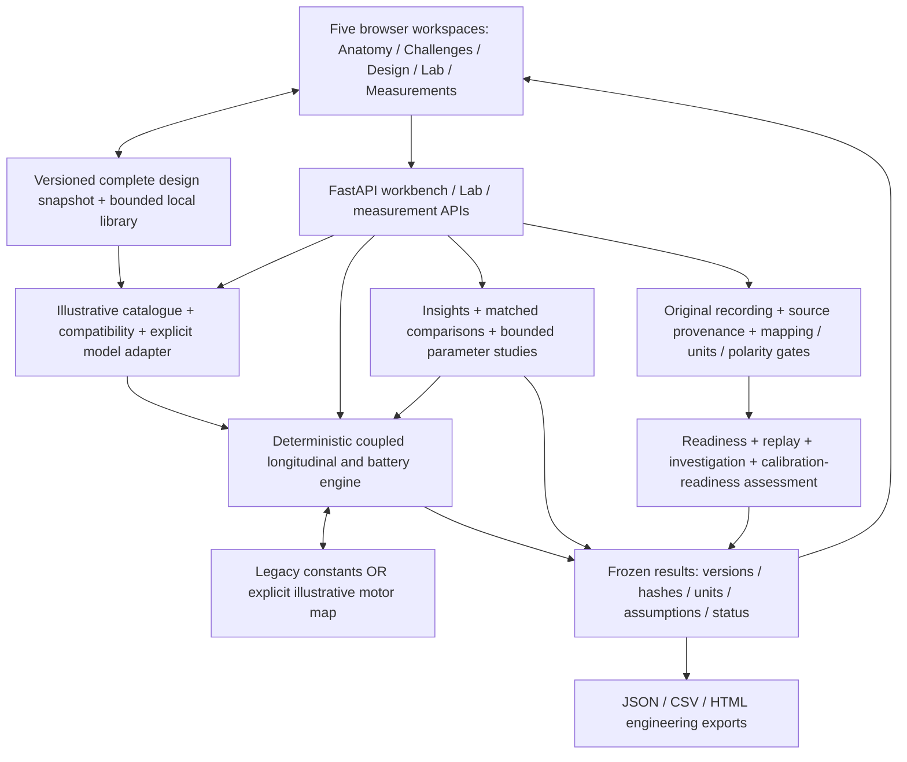

# VEUS workbench architecture

Current application: **3.0.0rc1**. Configuration/schema/model versions are independent
and remain compatible with historical results. Five workspaces share one active design;
Python owns numerical calculations and the browser owns presentation and replay.

## Module and API boundaries

| Responsibility | Implementation / route |
| --- | --- |
| Original content, system diagrams, navigation | `static/workbench/{app,schematic}.js`, shared SVG/appearance, `/api/workbench/content` |
| Complete v2 designs, catalogue, checks, adapter | `workbench/{design,catalogue,engineering,adapter}.py`; `/api/workbench/v2/{design,presets,evaluate,adapter}` |
| Experiment configuration / engine / execution / reports | `lab/{schema,kernel,runner,report}.py`; `/api/lab/{run,export}` |
| Shared physical equations | `sim/{session,dynamics}.py`, battery/motor/transmission models in `model/` |
| Explicit optional efficiency map | `model/efficiency_map.py`; selected by `efficiency_model`, frozen grids/region/hash in mapped results |
| Engineering Insights and controlled studies | `workbench/{insights,design_analysis,powertrain_comparison}.py`; `/api/workbench/v2/{insights,design-analysis,powertrain-comparison}` |
| Original data and preserved investigation | `readiness/`, `replay/`, `investigation/`, `validation/`; `/api/workbench/v2/measurements/...` delegates to retained services |
| Evidence-specific validation audit / reports | `workbench/validation_readiness.py`; no matched VED residuals or fit when evidence is insufficient |
| Shared clock / pure driving visualization | `static/replay-controller.js`, `workbench/lab-scene.js`, `workbench/driving-scene-state.mjs`; no lateral physics |

The main entry is `/`; deep links use `?workspace=anatomy`, `challenges`, `design`,
`simulation` or `measurements`. The former `optimization` link redirects to Design Studio.
Browser Back and roving keyboard tabs preserve navigation. The retained toolset lives
at `/engineering`; legacy APIs/WebSockets remain isolated from the modern shell.
`/engineering-docs/` serves checked-in documentation; Markdown may download as text.

## State, snapshots and reproducibility

`design-state.js` owns one complete active design, its current evaluation and a bounded
browser library (16 designs / 180 KB). Preset preview is separate from explicit apply.
Unsaved edits are labelled; structural checks do not imply physical validation.
An evaluation response is applied only while its workspace/generation and submitted
snapshot still match. A newer edit is never overwritten by an older response.

Insights and Lab send complete snapshots to Python. Comparisons preserve matched
conditions; hashes identify configuration, run and source where supported. Results
remain frozen after later design changes. Null/default map selection is omitted from
legacy serialization, preserving numerical and export fingerprints. No existing model,
source recording, catalogue assumption or schema version is changed by the 3.0 UX work.
Application version comes from `veus.__version__` and FastAPI metadata; shell/Lab labels
use its human-readable RC identifier.

Measurements preserve original samples, gaps, provenance and unknown-polarity gates.
Validation has an explicit visible model selector. A retry clears the previous assessment
and disables exports until successful; workspace cleanup aborts pending work. Exported
readiness reports contain frozen inputs/hash and specific blockers. Paired-error arithmetic
is not evidence authentication; current unmatched VED evidence remains INCONCLUSIVE.

## Runtime and accessibility

The modern shell uses native HTML/CSS/ES modules and original SVG; no build, framework,
GPU or new runtime dependency. Design, Lab and measurement modules load on demand.
Static workspaces do not poll or animate. Playback uses the existing clock and runs
requestAnimationFrame only while active; seek reconstructs directly from stored samples.
Reduced motion preserves controls/telemetry while suppressing decorative scene effects.

Native labels, visible focus, status announcements, roving tabs, skip navigation and
responsive light/dark theme tokens are preserved. Contextual links explain the workflow;
mobile controls have 44 px minimum height. Reports and dense evidence can scroll without
forcing page overflow. Chromium coverage is evidence for Chromium, not cross-browser
certification. No Windows execution is claimed.

## Historical v1 design boundary (API preserved)

Version 1 rejects unknown keys, unsupported versions, non-finite numbers and invalid
ranges. Usable capacity cannot exceed gross capacity. Minimum, nominal and maximum
battery voltages must be ordered; inverter and motor-drive DC envelopes must contain
the battery range; inverter continuous power must cover the declared motor rating;
charger voltage capability must reach maximum pack voltage.

These nameplate checks are **necessary, not sufficient**. They do not validate current
limits, duty cycles, insulation, connector compatibility, cooling, motor phase voltage,
transient overload, packaging or safety. The motor fields explicitly describe its
**drive DC envelope**, not phase voltage. An inverter output-current/power/voltage
map and matching motor/control model are future dependencies.

Chemistry, motor topology and inverter technology are enumerated labels only. No
automatic efficiency, resistance, mass, price or charging curve is inferred. All
configuration values remain classified `illustrative`. Gross/usable energy, battery
mass, body mass excluding battery, drag area inputs, rolling resistance, ratio,
voltage envelopes, charging limits and editable tariffs have explicit units. Thermal
behaviour is `not_modelled`; drivetrain is one equivalent motor, not an asserted axle
layout. Tariffs are assumptions, not market prices. No EUR/km or charging time is
calculated without energy demand and charging models.

In v1, validated configurations can be exported and imported as JSON with a deterministic
canonical configuration hash. Browser edits are held in memory; only checked designs
become the baseline when navigating. Refresh does not persist a design. That historical behaviour is superseded in the v2 editor by a persistent library,
specification comparisons and representative component selection. Commercial records
remain unpopulated.

## Migration and engineering boundaries

The earlier foundation audit remains in [audit.md](audit.md); its placeholder/prototype
findings are historical, not the current Lab/Measurements capability. Keep retained
frontend dependencies until replacement workflows prove parity. No model code should
move into the browser. No ADAS/manual driving or standalone Optimization workspace is
restored. Independent physical validation requires matching inputs and reference data;
software regression success does not establish physical validation.

See [design contracts](design-engineering.md), [Lab equations](simulation-lab.md),
[analysis](engineering-analysis.md), [map boundaries](powertrain2.6.md),
[measurement parity](measurement-migration.md) and [release readiness](../veus3/release-readiness.md).
