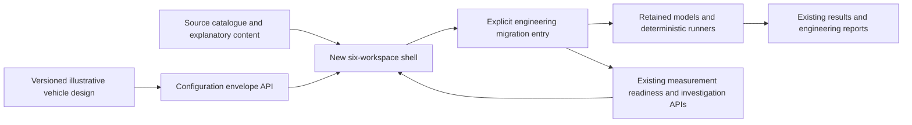

# VEUS workbench architecture

The workbench separates explanatory knowledge, design intent, experiment execution,
results and presentation. It deliberately does not connect technology labels to new
physics. Read [the audit and retirement matrix](audit.md) before changing boundaries.

The shell does not import the legacy frontend scripts, create a WebSocket,
simulate a vehicle or generate charts from fabricated data. The Measurements page
uses the existing catalogue's actual importer metadata and directs users to the
working evidence tools. Placeholder Lab readouts use an em dash and unavailable
labels, never zeros or simulated performance values. Optimization shows study
definitions, not numerical improvements. Design inputs are illustrative configuration
values, not results or manufacturer specifications.

## Current modules and routes

| Layer                 | Responsibility                                                         | Foundation implementation                                                |
| --------------------- | ---------------------------------------------------------------------- | ------------------------------------------------------------------------ |
| Engineering models    | SI dynamics, battery energy, limits                                    | Existing `model/`, `sim/`; unchanged                                     |
| Engineering knowledge | Sources, component roles, challenge mechanisms                         | `workbench/content.json` with explicit classifications and review status |
| Component catalogue   | Future sourced products, conditions and uncertainty                    | 13 representative records; no commercial specifications                  |
| Vehicle configuration | v1 preserved; v2 snapshots, checks, specifications and bounded library | `workbench/schema.py`, bounded validation API                            |
| Experiments           | Scenario definitions, deterministic execution                          | Existing `testing/`; new design-to-runner adapter not yet implemented    |
| Results               | Raw traces, metrics, acceptance, provenance                            | Existing testing/validation/investigation reports; unchanged             |
| Optimization          | Study objectives/controlled conditions                                 | Frontend study prototype; no optimizer or performance score              |
| Measurements          | Import, data readiness, polarity/coverage gates                        | Existing services and migration UI; real catalogue metadata in new shell |
| Presentation          | Original SVG, accessible annotations, tabs, themes                     | `static/workbench/`; independent of old global UI state                  |

- `/` serves the new foundation shell. `?workspace=anatomy` is the default;
  `challenges`, `design`, `simulation`, `optimization`, `measurements` are deep links.
- `/engineering` and `/engineering/` explicitly serve the previous toolset.
  `?workspace=analyse` opens measured-data tools and model experiments;
  `?workspace=validate` opens engineering settings and existing simulation tools.
- `/static/index.html` is still the historical static entry point. It is not the
  default page. Old scripts/styles/sprites remain loaded only by the migration UI.
- `/api/workbench/content` provides explanatory content and its source catalogue.
- `/api/workbench/design` provides labelled illustrative defaults;
  `/design/schema` provides JSON Schema; `/design/validate` validates at most 64 KB.
- Existing HTTP APIs and WebSockets are retained unchanged. `/engineering-docs/`
  serves checked-in technical documents and evidence; Markdown may download as text.

## Versioned design engineering

Version 2 is implemented in `workbench/design.py`, `catalogue.py`, `engineering.py`
and `adapter.py`; v1 routes remain unchanged. The lazy-loaded `design-studio.js`
uses shared `design-state.js` for one active design and a bounded local library.
Only the active workspace is rendered. `schematic.js` and `vehicle.css` are shared;
selection/body/view changes update existing SVG elements. The standalone duplicate
flow renderer was removed. Measured recording metadata now loads only on entering
Measurements; component records and editor styles load only on entering Design Studio.

Current contracts, mass accounting, calculations, readiness and storage limits are
authoritative in [design-engineering.md](design-engineering.md). Anatomy and design
do not execute physics, poll, animate continuously or open WebSockets. The model
adapter prepares separate retained dynamics and energy model objects; it does not
claim a verified coupled experiment runner.

## Historical v1 design boundary (API preserved)

Version 1 rejects unknown keys, unsupported versions, non-finite numbers and invalid
ranges. Usable capacity cannot exceed gross capacity. Minimum, nominal and maximum
battery voltages must be ordered; inverter and motor-drive DC envelopes must contain
the battery range; inverter continuous power must cover the declared motor rating;
charger voltage capability must reach maximum pack voltage.

These nameplate checks are **necessary, not sufficient**. They do not validate current
limits, duty cycles, insulation, connector compatibility, cooling, motor phase voltage,
transient overload, packaging or safety. The motor fields explicitly describe its
**drive DC envelope**, not phase voltage. An inverter output-current/power/voltage
map and matching motor/control model are future dependencies.

Chemistry, motor topology and inverter technology are enumerated labels only. No
automatic efficiency, resistance, mass, price or charging curve is inferred. All
configuration values remain classified `illustrative`. Gross/usable energy, battery
mass, body mass excluding battery, drag area inputs, rolling resistance, ratio,
voltage envelopes, charging limits and editable tariffs have explicit units. Thermal
behaviour is `not_modelled`; drivetrain is one equivalent motor, not an asserted axle
layout. Tariffs are assumptions, not market prices. No EUR/km or charging time is
calculated without energy demand and charging models.

In v1, validated configurations can be exported and imported as JSON with a deterministic
canonical configuration hash. Browser edits are held in memory; only checked designs
become the baseline when navigating. Refresh does not persist a design. That historical behaviour is superseded in the v2 editor by a persistent library,
specification comparisons and representative component selection. Commercial records
remain unpopulated.

## Frontend interaction and accessibility

Native controls handle theme, component alternatives and forms. All ten SVG component
groups have accessible names, keyboard focus, Enter/Space selection and a shared live
description. Clicking selects the detailed inspector; hovering/focus previews function.
The energy-path schematic distinguishes propulsion, conditional regeneration, AC
charging and auxiliary supply. AC conversion bypasses the traction inverter; DC fast
charging's offboard conversion is documented. Paths are qualitative, not simulated.

The compact bottom tablist has six icons, accents, active states, roving tab stops,
Left/Right and Home/End navigation. Deep links and browser history restore workspace
navigation; theme preference is browser-local with storage failure fallback. Light and
dark styles use local CSS, system fonts and no new framework or external asset requests.
A navy instrumentation surface is reserved for Lab. Media queries keep the complete
anatomy drawing above the dock on the target laptop and wrap the dock on narrow screens.

## Migration and removal gate

Do not append new workbench state to dashboard.js or reproduce calculations in JS.
Replace migration tools one verified workflow at a time: extract measurement service
and replay state contracts first, add the deterministic experiment adapter separately,
then prove equivalent results/exports before deleting corresponding DOM code. Keep
historical feature refs and reports. ADAS and keyboard driving have no place in the
new primary UX; their backend dependencies and regression scenarios are currently
retained because session/testing import them. No file was proven safely isolated for
physical deletion in this milestone, and none was deleted to inflate test success.
