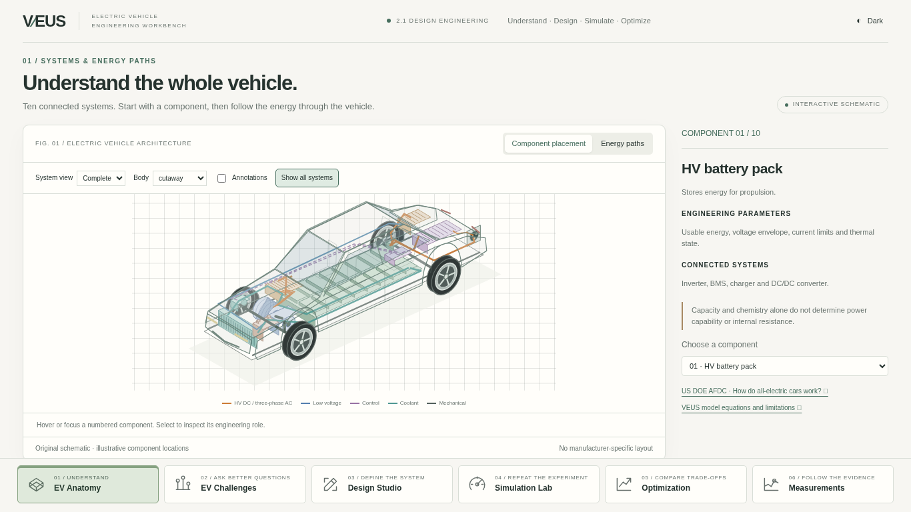
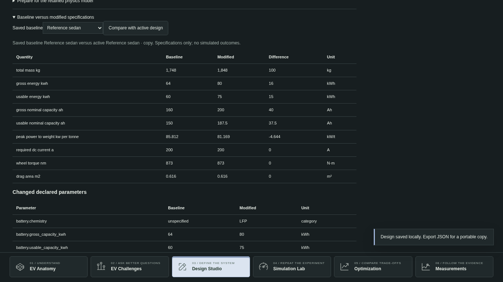

# VEUS 2.1 review evidence

Baseline: `fb1b60b` on `feature/veus-2.0-engineering-workbench`. This milestone
implements design engineering and a reusable cutaway, not a stable release or a
full Simulation Lab. Main and `archive/veus-pre-2.0` are not changed.

## Delivered and bounded

- Original recognizable sedan cutaway: shaped bonnet/cabin/roof/rear, four rimmed
  wheels, arches/axles, segmented battery, motor/shaft, gearbox, electronics,
  radiator, onboard charger, DC/DC, BMS, charge port and 12 V system.
- One renderer shared by Anatomy and Design Studio; incremental selection/filter/
  annotation/transparency updates and connected-system emphasis. Five qualitative
  paths distinguish propulsion, regeneration, AC charging, DC charging and auxiliaries.
- Thirteen typed **representative** component records, seven component kinds, one
  consolidated source record, explicit units/conditions/uncertainty and missing data.
- Version 2 resolved designs, structured compatibility, nine supported specification
  outputs with equations and assumptions; actual parameter/specification comparison.
- Local browser library: create/save/rename/duplicate, confirmed deletion, bounded
  JSON import/export, reload persistence and one shared active design.
- Explicit construction of existing longitudinal and energy model objects after
  acknowledgements. No default-vehicle substitution and no new physics engine.
- Root `AGENTS.md`, [repository map](../../REPO_MAP.md), one
  [progress checkpoint](../../PROGRESS.md) and the existing [roadmap](../roadmap.md).

Authoritative mathematical/contracts documentation:
[design-engineering.md](../design-engineering.md). This is the single source for
mass boundaries, equations, units, compatibility scope and adapter limitations.

## Representative actual screenshots

All nine PNGs are real application captures at **1366 × 768**, approximately
**1.43 MiB total**. No AI-generated vehicle artwork, fabricated screens, browser
chrome or raw oversized recordings are included. The vehicle SVG is original code,
conceptual rather than production CAD. Exact hashes/dimensions are in
[screenshots.json](screenshots.json).

| Review question                                                         | Capture                                               |
| ----------------------------------------------------------------------- | ----------------------------------------------------- |
| Is the whole cutaway recognizable without labels?                       | [Complete cutaway, light](complete-cutaway-light.png) |
| Which systems connect to the battery?                                   | [Battery emphasis](battery-connections.png)           |
| Are traction conversion and three-phase conductors identifiable?        | [Motor and inverter](motor-inverter.png)              |
| Is the cooling network separate?                                        | [Thermal view](thermal.png)                           |
| Does DC charging bypass the onboard AC converter and traction inverter? | [Charging path](charging-paths.png)                   |
| Does the body remain recognizable in dark mode?                         | [Opaque body, dark](complete-body-dark.png)           |
| Can components and real checked specifications be edited?               | [Functional studio, dark](design-studio-dark.png)     |
| Are uncertainty and incompatibility visible?                            | [Compatibility](compatibility.png)                    |
| Are comparisons actual specifications rather than simulated outcomes?   | [Baseline versus modified](design-comparison.png)     |




The example changes the representative 64 kWh/420 kg pack to an explicit
80 kWh/520 kg alternative. Total mass changes **1748 → 1848 kg** and usable nominal
capacity **150 → 187.5 Ah** at 400 V. This is an input/specification comparison,
not evidence that LFP causes a benefit, that usable driving range increases by a
particular amount, or that the motor can sustain peak output.

## Verification

- Baseline: **207 Python tests passed** ([output](baseline-tests.txt)).
- Final: **237 Python tests passed** ([output](python-tests.txt)); 30 new engineering
  cases cover catalogue metadata, unknowns, independent analytical cases, units,
  mass accounting, voltage/current/rated/peak limits, deterministic snapshots,
  comparisons, complete-import requirements and actual retained-model mappings.
- **9 playback-clock tests passed** ([output](clock-tests.txt)).
- **Five browser suites pass:** [workbench](workbench-browser.json),
  [Drive migration](legacy-drive.json), [Replay migration](legacy-replay.json),
  [Guidance migration](legacy-guidance.json), [Investigation migration](legacy-investigation.json).
- Ruff 0.14.3 F/E9 checks pass for new backend/tests/measurement helper; `pip check`
  reports no broken requirements. Existing model, controller, sensor, dataset,
  readiness, replay and investigation implementations remain unchanged.

New browser checks exercise all ten subsystem targets, cable highlighting, all
views/body presets, annotations, five energy paths, keyboard access, component
selection, invalid design feedback, save/reload/duplicate, deletion confirmation,
JSON round-trip, comparison invalidation, model acknowledgements, responsive widths
1366/1024/820/390, themes, corrupt-storage preservation and blocked-storage feedback.
No useful test is deleted; the foundation browser's v1-editor assertions are updated
to its functional v2 replacement, while v1 API tests remain intact. One existing
Starlette/httpx deprecation warning remains.

```bash
python -m pytest -q
node --test tests/browser/replay-controller.test.cjs
# Start Uvicorn first. Playwright/Chromium are optional external development tools.
node tests/browser/workbench.cjs
node tests/browser/drive.cjs
node tests/browser/replay.cjs
node tests/browser/guidance.cjs
node tests/browser/investigation.cjs
```

Browser overrides: `PLAYWRIGHT_MODULE`, `CHROMIUM_PATH`, `VEUS_URL`, `VEUS_SCREENSHOTS`.
Legacy suites use the `/engineering` base URL. Temporary full-workspace captures
stay in `/tmp`; only these representative states are committed.

## Before and after efficiency

[Full metric table](performance-table.md) · [server/source baseline](performance-before.json) ·
[server/source after](performance-after.json) · [browser before](browser-before.json) ·
[browser after](browser-after.json) · [compact summary](summary.json).

Measurements use the same managed Linux machine and existing Python environment.
One warm-up is excluded, with three repeated samples; startup polling is 10 ms,
server idle samples are 1 s, and browser idle observation is 1.2 s. The environment
is shared, not an exclusive benchmark host. Timing variation does not demonstrate
a speed improvement or a Windows laptop performance guarantee.

- Runtime/development installation stays **36 distributions / 297,534,332 summed
  environment file bytes**, with an identical freeze. The five direct application/
  reporting requirements are unchanged. No extra runtime or build dependency.
- Additional source/geometry is justified by functional contracts, persistence and
  the original cutaway; source size is reported, not disguised as a reduction.
- Static Anatomy/Design start no WebSocket or continuous simulation. Sampled idle
  requests, intervals, pending animation frames and timeouts are all **zero**.
- The new editor module, stylesheet and component catalogue load only when Design
  Studio is entered. The measured-recording catalogue is no longer fetched at
  initial Anatomy load. Geometry is shared rather than duplicated across workspaces.
- Browser first-load body bytes exclude HTML; source byte counts include stored
  code, not only what is transferred. JavaScript heap is **not total browser RSS**.
  Main-thread task fraction is **not total browser-process CPU**. Selection latency
  measures synchronous handler work, not complete presentation latency.
- API latency compares old v1 envelope validation with new full v2 evaluation: these
  perform different work, so the difference is not an optimization/speedup metric.
- Active application inventory covers `veus/` source/data/assets, excluding bytecode;
  Python nonblank/non-comment lines include docstrings, with AST statement counts
  supplied as a separate measure. Documentation/screenshots/tests are not runtime assets.
- Git object-store size is recorded separately in the after snapshot (12,036 KiB
  before this milestone commit). No history is rewritten; deleting a renderer does
  not shrink old Git objects. Temporary baseline-source archives and test profiles
  are not a new runtime environment and are not committed.

Reproduce server/source measurements with `scripts/measure_workbench.py` using a
read-only baseline source snapshot and `--v2` for the current evaluator. The baseline
was obtained from `git archive fb1b60b` into `/tmp`, without a new checkout/worktree
or environment. Browser snapshots use `tests/browser/performance.cjs`. Installed
size is summed file bytes, not unique disk blocks or package download size. Missing
measurements (total browser RAM, target-laptop CPU/GPU, token/agent costs) are not invented.

## Retirement and development decisions

The old standalone `flowSVG` diagram was proven unused after moving every energy
mode onto the shared cutaway and was removed. Other legacy assets still support
measurement/calibration/simulation migration and remain intact. No blanket asset
purge, new ADAS feature, history rewrite, account service or database is introduced.

Two implementation agents had disjoint ownership: backend contracts/tests/math
reference and shared SVG/CSS. The coordinator owned editor/state/integration and
verification. No nested delegation or runtime agent framework was introduced.
Existing audit, source-access records and test runners were reused. Efficiency
observations are qualitative where no real measurement exists; no token/cost/time
savings are claimed.

## Limitations and next boundary

- Catalogue records are representative assumptions, not authenticated manufacturer
  specifications; no technology label determines an efficiency or lifetime benefit.
- Phase-current/control maps, peak duty and thermal/packaging/safety compatibility
  remain incomplete. Default overall status is therefore **insufficient data** even
  when supported nameplate checks pass.
- Adapter readiness is preparation for model inspection, not a verified coupled
  electrical/mechanical experiment. It constructs existing models with explicit
  mappings; the new Simulation Lab still does not execute full experiments.
- V1 mass definitions cannot be auto-migrated safely; import gives actionable guidance
  instead of guessing component masses. Reconstruct a complete v2 snapshot explicitly.
- Local storage is browser/origin-specific, bounded and not a portable backup. Unsaved
  drafts and cleared browser data are not persistent. Export JSON; no cross-device sync.
- No range, charging-time, ageing, cost, track dynamics or optimization algorithm is
  added. VED evidence gates and physical-validation **INCONCLUSIVE** status are preserved.

Stop at VEUS 2.1. Follow the existing roadmap for separately verified next steps.
