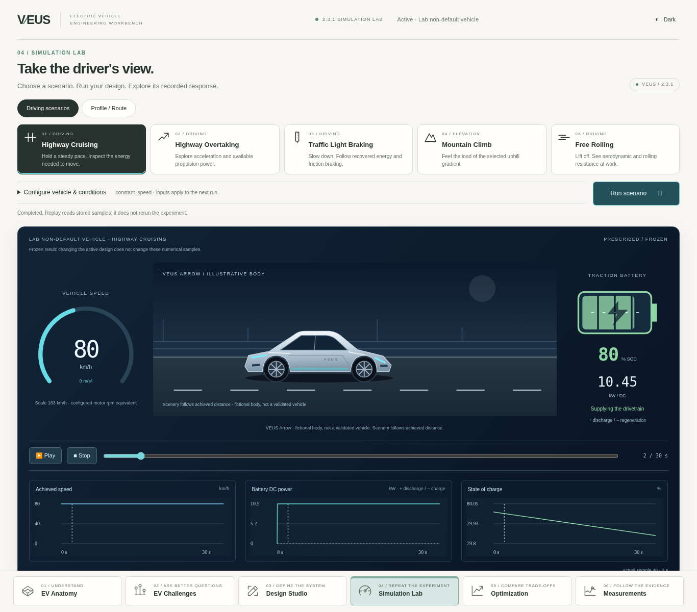
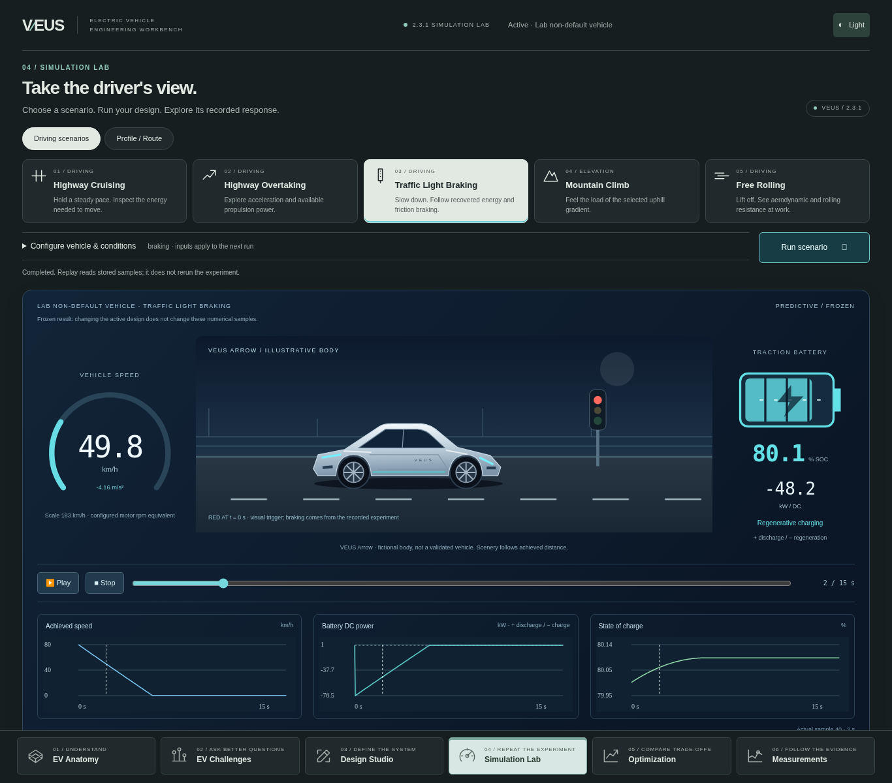
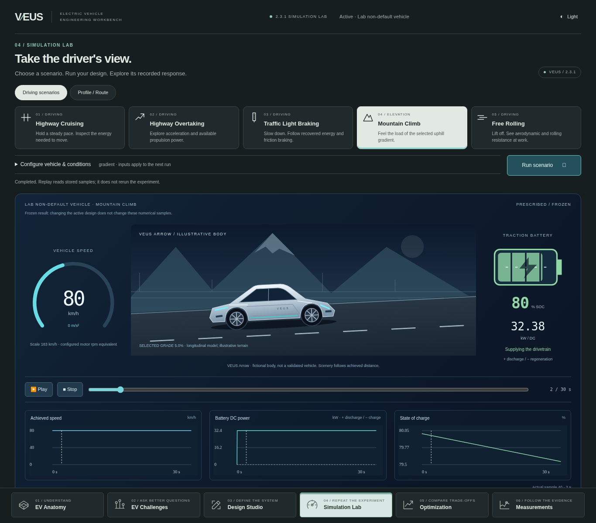

# VEUS 2.3.1 — cockpit verification

UI-only milestone from `e6522a3`, on `feature/veus-2.0-engineering-workbench`.
No main merge, stable release, physics development or 2.4 work.

Five cards map to the existing five experiments. The original lightweight fictional
VEUS Arrow SVG and scenery follow the recorded achieved distance, with the actual
selected gradient. Speed arc/digital speed, SOC-fill battery and signed power,
three cached plots, cursor findings and Play/Pause/Stop share one replay clock.
Profile/Route imports, source/coverage policy, frozen identity and all three exports
remain available. Technical parameters/acknowledgements are collapsible. No defaults
or numerical contracts changed. [Display semantics and limits](../simulation-lab.md#231-cockpit-ui).

## Verification

- **267 Python tests passed, 25.80 s**; one existing Starlette/httpx deprecation warning.
- **9 playback-clock tests passed**.
- **6 browser suites pass**: Lab, workbench, retained driving, replay, guidance and investigation. The first legacy-driving run hit its existing fixed-150-ms pause assertion under parallel load; rerunning the affected suite alone passed with its original assertion intact. No legacy application changes were made.
- [Lab browser evidence](lab-browser.json): five scenario mappings, exact equality of all five frozen experiment hashes against the 2.3 golden results, three cursor times, actual SOC fill/power, regenerative charging, tight-current-limit red state, fitted gauge bounds, arc response, Stop/reset, paused/end motion, lifecycle cleanup and exports.
- Profile/Route mode still executes pinned sources, rejects missing gradient until explicitly acknowledged, imports both CSV types and preserves absent geography and frozen source identity. Themes and widths 1366/1024/820/390 are checked; no narrow-screen capture was generated.
- `git diff e6522a3 -- veus/lab veus/model veus/sim requirements.txt requirements-lock.txt` is empty. No Python model/controller, datasets, dependencies or result contract changed. `pip check` and code whitespace checks pass.
- Existing browser suites accept `VEUS_CAPTURE=0` to suppress redundant screenshots; their useful assertions remain. Only the three captures below were retained. One implementation agent, no delegation or external research.

## Limited performance comparison

Existing `scripts/measure_workbench.py --v2` and `tests/browser/performance.cjs`
were each run once, using their built-in warm-up plus three retained trials.
Before records are the preceding 2.3 final measurements; after records are included
alongside them. Lab seek samples come from its real browser regression. No repeated
performance investigation or new benchmark dependency was added.

| Comparable metric | 2.3 | 2.3.1 |
|---|---:|---:|
| Initial anatomy subresource body bytes | 96,937 B | 96,937 B |
| Startup server RSS, median | 43,672 KiB | 43,684 KiB |
| Lab JS/CSS/scene source bytes | 59,705 B | 78,500 B |
| Installed distributions | 36 | 36 |
| Summed installed environment files | 297,534,332 B | 297,534,332 B |
| Paused Lab background requests | 0 | 0 |
| Paused owned animation frames | 0 | 0 |
| Seek → next rAF callback, median of five warm samples | 15.4 ms | 13.4 ms |

The 18,795 B addition is lazy Lab code: original SVG artwork/scene transforms,
scenario cards, two additional cached telemetry canvases, fitted instrumentation
and compact findings. Old technical signal/rate controls, cutaway renderer and
sticky sidebar styles were removed. The unchanged replay-clock script is another
3,363 B, excluded from both Lab totals. Initial subresources exclude the navigation
HTML response; these figures are the existing script's decoded resource-body
metric, not compressed wire transfer. A 12 KiB RSS difference and sub-millisecond seek
variation are measurement noise, not meaningful gains or regressions. Server RSS
is not browser memory; the JS heap snapshot is not total Chromium process memory.
A shared cloud host and next-rAF callback do not establish desktop display latency
or a real-time guarantee. No thermal or electrical hardware safety is implied.

## Three actual captures

Default scenario conditions, saved nondefault illustrative vehicle, cursor at 2 s.
These are real executed results, not mock-ups. Captures use a 1366×1200 viewport;
ordinary laptop/mobile layouts were tested separately without extra evidence files.





The car is an original fictional visual body. Surrounding vehicles and terrain
are illustrative; there is no lane-change/collision model, overtaking-safety claim
or predictive route reconstruction. The braking light turns red at the declared
visual event t=0; it adds no controller. Physical validation stays **INCONCLUSIVE**.

## Update and launch in Anaconda Prompt

From the Git repository folder (back up uncommitted edits first):

```bat
git fetch origin
git switch feature/veus-2.0-engineering-workbench
git pull --ff-only
"%LOCALAPPDATA%\veus-venv\Scripts\python.exe" -m uvicorn veus.studio.main:app --port 8770
```

If this PC has no local environment, first run `python -m venv "%LOCALAPPDATA%\veus-venv"`
and `"%LOCALAPPDATA%\veus-venv\Scripts\python.exe" -m pip install -r requirements.txt`.
Open `http://127.0.0.1:8770/?workspace=simulation`. For ZIP downloads select the feature
branch; a ZIP has no Git metadata. `/engineering` remains available.
