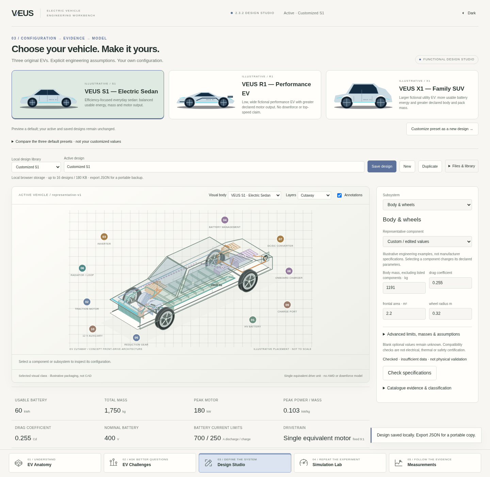
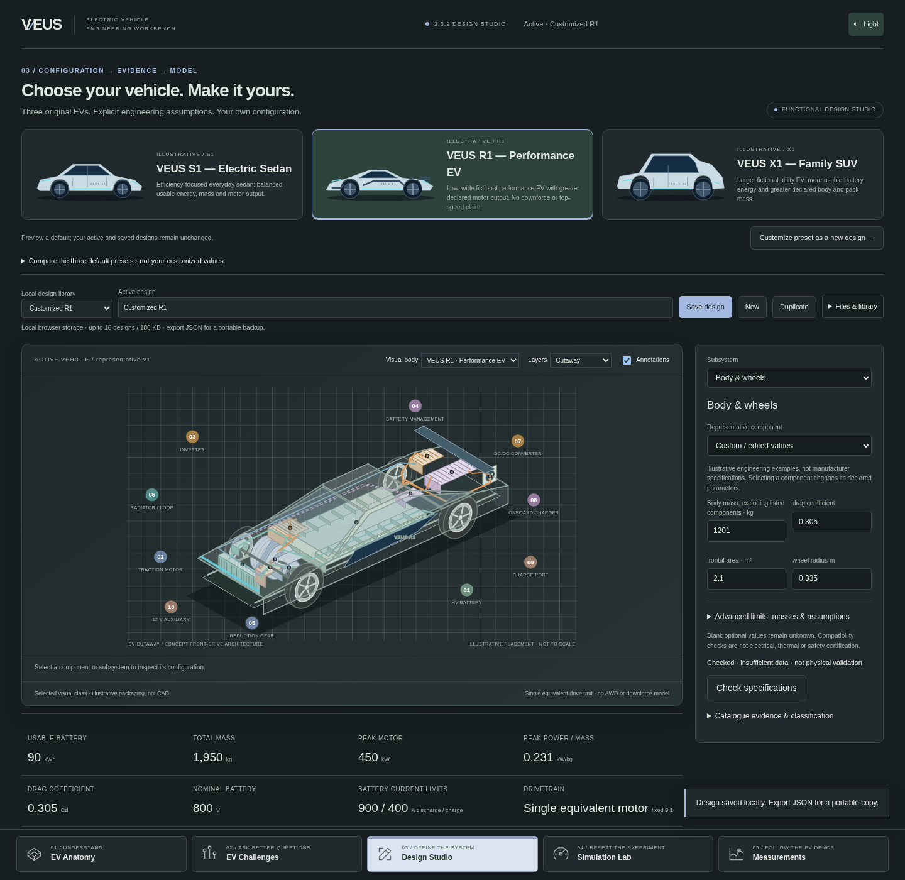
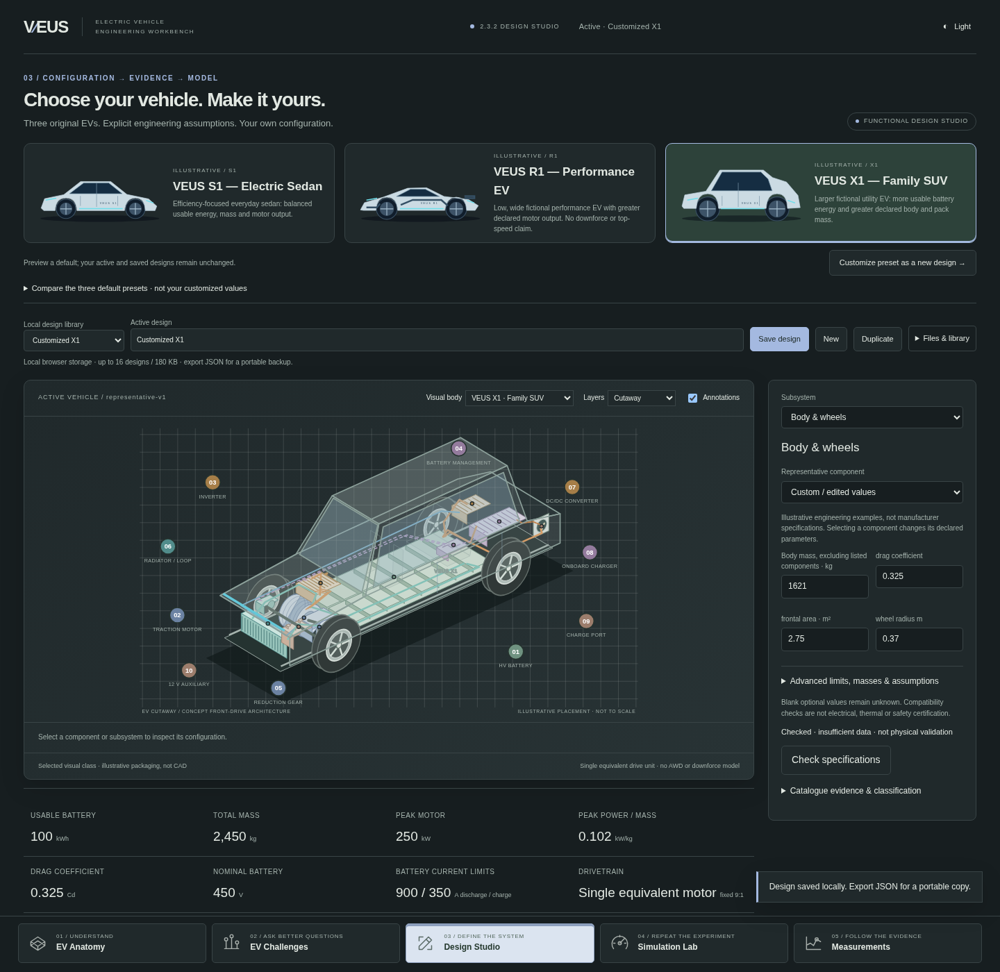

# VEUS 2.3.2 — vehicle configurator evidence

Baseline `0345540`, same feature branch. No main merge, stable release or next-phase work.

## Delivered and verified

Three original fictional bodies (sedan, low/wide performance, tall/angular SUV)
share identity metadata and artwork profiles between Design Studio and the Lab.
The axonometric renderer retains its existing selectable components and conceptual
paths, with explicit illustrative segmented-pack and single-motor envelopes. The
configuration editor, compact specifications and default-preset bars expose existing
quantities without introducing range, speed or charging-time predictions.

Preset cards preview without mutating active/saved designs. Applying a preset
explicitly creates an unsaved draft, and saving creates a new record. Appearance
alone changes no numerical parameters. Older designs use the documented R1 visual
fallback; missing/null appearance is omitted from normalization to preserve old
snapshots and exports. The five navigation entries retain measurements (marked
under development); old Optimization URLs migrate to Design Studio comparisons.

| Default | Usable kWh | Continuous / peak motor kW | Total kg | Cd | Nominal V | Battery discharge / charge A |
|---|---:|---:|---:|---:|---:|---:|
| S1 sedan | 60 | 145 / 180 | 1750 | .25 | 400 | 700 / 250 |
| R1 performance | 90 | 300 / 450 | 1950 | .30 | 800 | 900 / 400 |
| X1 SUV | 100 | 180 / 250 | 2450 | .32 | 450 | 900 / 350 |

Exact component values, mass boundaries, calculated specifications, readiness,
checks and limitations: [preset snapshots](preset-specifications.json). The
catalogue contains 27 illustrative records: original13 unchanged plus14 class/shared
envelopes. No manufacturer data or calibrated vehicle claim. Default Lab power
policy uses continuous ratings, regardless of the larger declared peak number.

## Tests

- **275 Python tests pass, 24.93 s**, including eight new preset/backward-compatibility cases. One existing Starlette/httpx deprecation warning.
- **9 playback-clock tests pass**.
- **7 browser suites pass**: original workbench, Lab, drive, replay, guidance, investigation, plus vehicle classes. Useful existing assertions remain; obsolete standalone-Optimization assertions now verify absence, redirect and saved comparisons.
- [Vehicle-class browser evidence](vehicle-classes-browser.json): explicit previews/drafts, preserved legacy record, appearance-only numerical equality, distinct meshes, pack update on component selection, single drive unit, keyboard component selection, customized save/export/import, shared Lab identity, frozen body after active-design switch, themes and 1440/1024/820/390 widths.
- [Lab browser evidence](lab-browser.json): original five numerical hashes exactly match prior golden results, along with replay, SOC, electrical-limit colour, exports, profile/route imports and cleanup tests.
- Backend checks verify existing default evaluation and run fingerprints plus byte fingerprints of old JSON/CSV/HTML exports. All three acknowledged adapters and deterministic finite Lab runs respect the existing limits.
- Changed Python files pass Ruff F/E9; `pip check` and whitespace checks pass. Physical models, coupled equations, dependency manifests and original datasets are unchanged.
- One scoped independent backend agent handled schemas/presets/backward compatibility while the coordinator implemented shared art, UI, navigation and integration. No nested delegation or external research.

## Limited comparable performance

Existing server/browser scripts each ran once (their warm-up plus three retained
samples). Before files are the final 2.3.1 samples. Full inventories and raw samples
are in `performance-before/after.json` and `browser-before/after.json`.

| Metric | 2.3.1 | 2.3.2 |
|---|---:|---:|
| Initial anatomy subresource body bytes | 96,937 B | 101,569 B |
| Server startup RSS, median | 43,684 KiB | 43,824 KiB |
| Server startup, median | .455 s | .458 s |
| Idle server CPU, sampled 1 s | 0% | 0% |
| Anatomy main-thread idle task fraction | .098% | .106% |
| Installed distributions | 36 | 36 |
| Summed environment file bytes | 297,534,332 B | 297,534,332 B |

The 4,632 B initial-resource increase supports shared class profiles/body geometry;
removing the obsolete standalone study prototype offsets part of it. Design editor,
preset retrieval and component configuration remain lazy workspace operations.
The original and new axonometric bodies share the same subsystem/connection renderer;
the Lab uses one shared side-art function rather than three complete renderers.
No 3D framework, image bundle, runtime AI or background simulation was added.
Small timing/RSS variations from a shared cloud host do not establish desktop
performance guarantees. JS heap, server RSS, source-tree bytes and total browser
memory are different measures. Frontend figures are decoded subresource bodies,
excluding the navigation HTML, not compressed network transfer.

## Exactly three actual Design Studio captures

Real saved/customized designs (Cd adjusted +.005 to exercise editing), not mock-ups.
Default preset values are in the table above. No additional narrow-screen or legacy
screenshots were generated for this milestone.





Illustrative body and component packaging are not CAD, inferred battery energy
density or a physical fit assessment. There is one equivalent motor, no AWD,
downforce/lateral model or hardware safety assessment. Existing constant-efficiency,
OCV and thermal/duty limitations persist. Physical validation is **INCONCLUSIVE**.

## Local PowerShell update and launch

In the repository folder (preserve local uncommitted work first):

```powershell
git fetch origin
git switch feature/veus-2.0-engineering-workbench
git pull --ff-only
& "$env:LOCALAPPDATA\veus-venv\Scripts\python.exe" -m uvicorn veus.studio.main:app --port 8770
```

Open `http://127.0.0.1:8770/?workspace=design`. If the environment is missing, use an
Anaconda-enabled Python to create it (`python -m venv "$env:LOCALAPPDATA\veus-venv"`)
and install `requirements.txt` with that environment's Python. ZIP copies need the
feature-branch download and cannot use Git update commands. `/engineering` remains.
