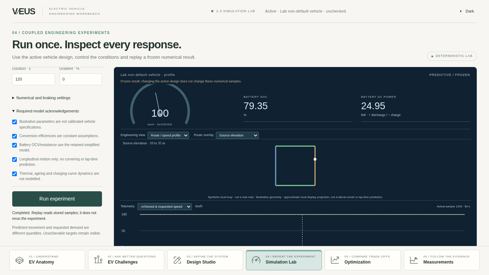
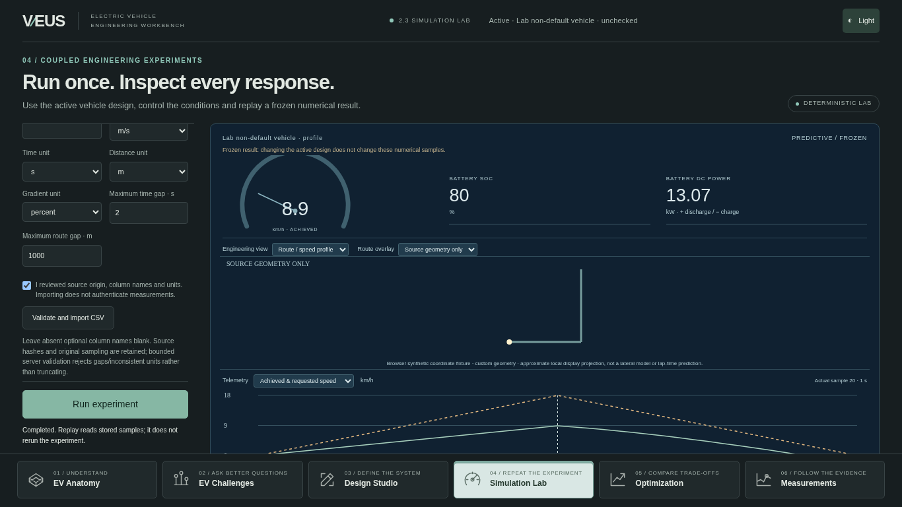

# VEUS 2.3 evidence

This is software/equation verification and illustrative engineering comparison.
Physical validation is **INCONCLUSIVE**. No main merge or stable release.
Baseline: `f49fe7c01cc6158f7b5d7d6229ab71666f75f720`, same environment and pinned dependencies.

## Verification

- Checkpoint A: **54 tests** before profile/route implementation; [record](checkpoint-A.json).
- Final full Python suite: **267 passed in 22.74 s**, including 30 Lab/input/reference tests. One existing Starlette/httpx deprecation warning.
- Clock suite: **9 passed**. All **6 browser suites** pass: workbench, Lab, retained drive, replay, guidance and investigation. Existing useful coverage retained; obsolete disabled-Lab prototype assertions replaced by real execution/acknowledgement tests.
- CLI smoke run produced request JSON plus all three exports in a fresh directory.
- Changed Python files pass Ruff F/E9, code whitespace checks (the original upstream NOTICE deliberately retains its two whitespace-only lines) and `pip check`. A broader repository Ruff check still finds three existing unused imports in untouched `test_energy.py`, `model/cell.py`, `sim/solver.py`; these are outside this change.
- [Lab browser evidence](lab-browser.json): five real experiments with saved nondefault parameters, shared clock/seeking without recalculation, frozen result identity, lifecycle cleanup, three real exports, full cycle-duration selection, time-only input without invented map, profile/route CSV imports, grade policy, themes and four widths. No page errors or WebSockets.
- [Workbench browser evidence](workbench-browser.json): keyboard, editor, persistence, import/comparison, storage failures and retained migration regressions.
- Closed-form checks include constant force, steady road demand, constant-deceleration braking, uphill coasting and gradient energy. Position-error convergence follows retained Euler O(dt). [Reference versus simulation figure](analytical-reference.svg).
- [Study snapshots/summaries](studies.json), [actual urban HTML report](urban-report.html) and [source investigation](source-investigation.json). Reproduce complete traces/reports using `python scripts/lab_studies.py --output /tmp/veus-lab-studies`. Exact raw sources and licence/NOTICE remain in `datasets/cycles/`.

## Comparable measurements

Existing `scripts/measure_workbench.py --v2` and `tests/browser/performance.cjs` ran before/after; one warm-up discarded, medians of three retained trials. Server script additionally measures four actual Lab runs per trial (first discarded). Full samples and inventories are in `performance-before/after.json` and `browser-before/after.json`.

| Metric | Before | After |
|---|---:|---:|
| Installed distributions | 36 | 36 |
| Summed installed environment files | 297,534,332 B | 297,534,332 B |
| Application source/assets (excluding caches) | 651,508 B | 778,771 B |
| Server startup | .318 s | .399 s |
| Server startup RSS | 42,948 KiB | 43,672 KiB |
| RSS after measured operations | 43,364 KiB | 49,312 KiB |
| Idle server CPU, 1 s window | 0% | 0% |
| Initial anatomy resource body bytes | 100,170 B | 96,937 B |
| Anatomy JS heap | 2,319,456 B | 2,316,964 B |
| Anatomy main-thread idle task fraction | .154% | .126% |

Startup increases about 81 ms because strict Lab schemas/routes are imported; the coupled solver and source parsing execute only on demand. Post-operation RSS includes actual new Lab execution, so it is not equivalent to old design evaluation alone. Initial transfer falls because the obsolete Lab prototype moved out of the eager shell; the new Lab module loads only when selected. Source/asset growth is recorded in the final inventory and implements the new functionality, not a compression improvement. No dependencies or framework were added. No latency difference is claimed as a speedup.

The representative **20 s acceleration / dt=.05 s / 401 rows** run takes **127.6 ms median including HTTP/JSON**, returning **525,580 B JSON**; median post-run server RSS **49,312 KiB**. Result retention is bounded (one browser result, no server cache); the full tick trace is evidence, not silently decimated. Use coarser explicit dt for long profiles, within the 12,000-tick limit.

Lab playback measurements are in `lab-browser.json`: five warm seek-input→next-rAF callback samples, zero paused background requests/owned animation frames, and a Chromium JS-heap snapshot. These are not display latency, total browser memory or a real-time guarantee. Anatomy/browser heap, server RSS, installed file size and source-tree size are different quantities. Measurements from a shared cloud host do not predict university-PC performance.

## Actual application captures



[Mobile capture](lab-mobile.png). The route is synthetic. Captures show actual frozen numerical output, not a design mock-up. More temporary captures were deliberately not added to Git.

## Local update (Anaconda Prompt, Git checkout)

```bat
git fetch origin
git switch feature/veus-2.0-engineering-workbench
git pull --ff-only
python -m venv "%LOCALAPPDATA%\veus-venv"
"%LOCALAPPDATA%\veus-venv\Scripts\python.exe" -m pip install -r requirements.txt
"%LOCALAPPDATA%\veus-venv\Scripts\python.exe" -m uvicorn veus.studio.main:app --port 8770
```

Run in the repository folder containing `veus` and `requirements.txt`, then open `http://127.0.0.1:8770/?workspace=simulation`. ZIP downloads have no Git metadata: download this feature branch or clone it first. Existing local edits should be committed or backed up before updating.
