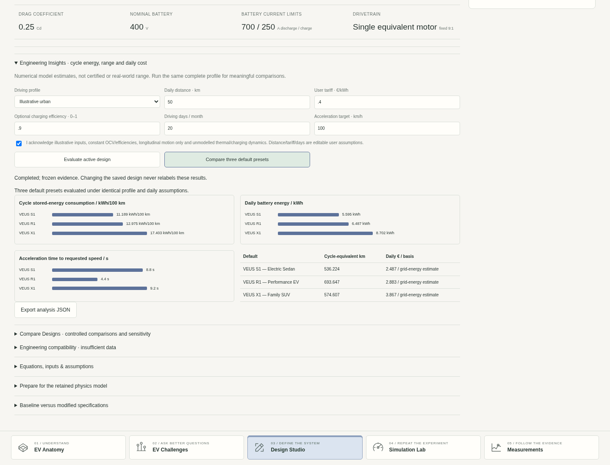
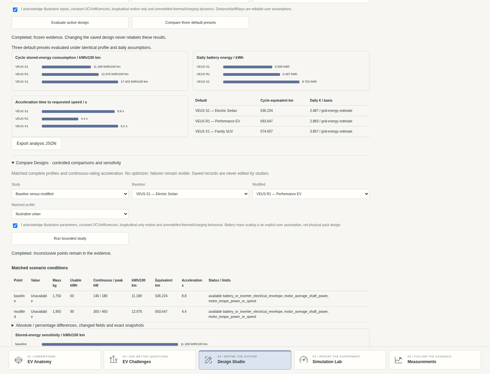
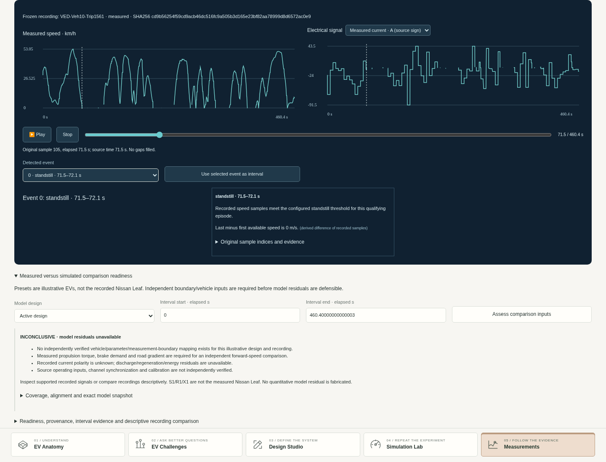

# VEUS 2.3.3 → 2.4 → 2.5 verification

Baseline `c039fb8`, feature branch only. No main merge, stable release, thermal,
charging-curve, ageing or later-phase work.

## Sequential checkpoints

- [A](checkpoint-A.json): Engineering Insights focused browser/arithmetic/SOC/continuous-policy checks passed before controlled-analysis implementation. The delegated service subsequently passed16 focused tests, including source-aware hashes, heat accounting, .05 m/s tracking guard and frozen exports.
- [B](checkpoint-B.json): six controlled-study tests plus16 Insights tests and the browser comparison/sweep/export workflow passed before measurement migration began. An independent steady-speed force-balance reference verifies drag sensitivity.
- [C](checkpoint-C.json): four migration tests prove exact old/new JSON/CSV/HTML parity, source/event/interval preservation, absent-signal/unit handling and inconclusive model gating; the browser import/readiness/events/cursor/export/mobile workflow passes.

The implementation used one scoped independent task for Phase A's numerical service.
The coordinator implemented UI/integration and all later phases sequentially; no
nested delegation or external dataset research. No existing model was rewritten.

## Numerical examples

All values are **illustrative model outputs**, not measured vehicle performance.
Same complete synthetic urban profile (120 s), dt=.2 s, continuous ratings, existing
constant OCV/efficiencies, no auxiliaries/thermal/ageing. Range extrapolates full
usable chemical energy with the same cycle consumption; it is not certified,
real-world or remaining range. Acceleration is a separate bounded30 s run to100 km/h.
Daily assumptions:50 km, user tariff€0.40/kWh, charging efficiency.90,20 driving days.
Exact snapshots, metrics, gates and full-run hashes: [examples](examples.json).

| Default | Stored kWh/100 km | Cycle-equivalent km | Daily estimated grid € | Modelled 0–100 km/h s |
|---|---:|---:|---:|---:|
| S1 | 11.189 | 536.224 | 2.487 | 8.8 |
| R1 | 12.975 | 693.647 | 2.883 | 4.4 |
| X1 | 17.403 | 574.607 | 3.867 | 9.2 |

These extrapolations are optimistic under simplified flat-road/no-auxiliary
assumptions; they do not establish actual road range. Infeasible movement, SOC
boundaries or invalid coverage suppress range/daily extrapolations. Unknown charging
efficiency leaves grid cost unavailable, with battery-energy cost a separate proxy.

[Battery trade-off summary](battery-tradeoff-summary.json), explicit7 kg per usable
kWh and held voltage/resistance/current assumptions:

| Usable kWh | Battery kg | Total kg | Stored kWh/100 km | Equivalent km |
|---|---:|---:|---:|---:|
| 50 | 350 | 1680 | 10.793 | 463.262 |
| 60 baseline | 420 | 1750 | 11.189 | 536.224 |
| 70 | 490 | 1820 | 11.586 | 604.173 |
| 90 | 630 | 1960 | 12.381 | 726.934 |

Additional mass raises consumption in this controlled model, while added usable
energy still raises cycle-equivalent range. This does not select an optimum or
validate a physical pack. Summary JSON deliberately excludes preview traces and is
not an export payload; the exact study request reproduces the original full result
hash. JSON/CSV/HTML exports are exercised through the application, without retaining
duplicate megabyte reports in Git.

## Integrated verification

- **301 Python tests pass in30.24 s** (275 baseline +16 Insights +6 controlled analysis +4 migration). One existing Starlette/httpx deprecation warning.
- **9 playback-clock tests pass**.
- **8 browser suites pass**: workbench, vehicle classes, Lab, retained drive, replay, guidance, investigation, and the complete engineering workflow. No useful legacy assertions removed. The original workbench test now explicitly waits for asynchronous import completion and source loading before its existing persistence/data assertions, avoiding a stale-DOM race exposed during integration.
- Historical model/run/export fingerprints remain unchanged. The physics/model/Lab source, datasets and dependency manifests have no diff from the baseline. Measurements use the same processing function; exact parity is established, not inferred from screenshots.
- Changed Python passes Ruff F/E9, `pip check` and whitespace checks. No dependencies added or removed.
- Model-versus-measurement residuals are deliberately **unavailable/INCONCLUSIVE**: the VED inputs lack a verified model/vehicle/boundary mapping and independently verified current polarity/forward inputs. Supported recorded-signal investigation and descriptive recording comparison are functional; no physical validation or calibration is claimed.

## Limited comparable measurements

Existing server and browser benchmark scripts ran once with their built-in warm-up
and three retained samples. The server script's new optional `--insights` flag
measures one representative analysis per trial using the existing infrastructure.
Raw before/after samples and inventory are alongside this document.

| Metric | Before | After |
|---|---:|---:|
| Initial anatomy subresource body bytes |101,569 B |98,233 B |
| Startup server RSS, median |43,824 KiB |44,172 KiB |
| Startup time, median |.458 s |.464 s |
| Sampled idle server CPU |0% |0% |
| Anatomy main-thread idle task fraction |.106% |.177% |
| Installed distributions |36 |36 |

Representative old-default design, full120 s illustrative urban cycle plus30 s
acceleration, dt=.2: **156.1 ms median including HTTP/JSON**, **134,204 B JSON**,
**49,648 KiB post-analysis server RSS**. Previews are bounded to400 original rows
per run; full requests and complete-result hashes remain reproducible. Studies
allow at mostfive variants plus baseline, with failed points retained; work shares
two CPU slots and uses the existing Lab tick budget. The browser stores one frozen
result, not an unbounded cache.

Initial resources fall because the obsolete Measurements placeholder moved into a
lazy functional module. New services modestly increase startup memory. The unchanged
v2-evaluate latency was1.7→4.0 ms in these shared-host samples; this small absolute
operation is not a model/UI speedup comparison and no performance improvement is
claimed. New analysis runtime has no equivalent old operation. Source assets,
server RSS, JS heap and total browser memory are different quantities; subresources
exclude navigation HTML and are decoded bodies, not compressed wire transfer.
Cloud rAF/CPU/timing samples do not guarantee Windows-laptop performance.

## Three real application captures





No extra vehicle, legacy or narrow-screen captures were retained.

## Local PowerShell launch

In the Git repository folder, preserve local edits before updating:

```powershell
git fetch origin
git switch feature/veus-2.0-engineering-workbench
git pull --ff-only
& "$env:LOCALAPPDATA\veus-venv\Scripts\python.exe" -m uvicorn veus.studio.main:app --port 8770
```

Open `http://127.0.0.1:8770/?workspace=design` or `/?workspace=measurements`.
If the environment does not exist, create it using an Anaconda-enabled Python and
install the unchanged requirements. ZIP copies need the feature-branch download.
`/engineering` remains available. Physical validation remains **INCONCLUSIVE**.
