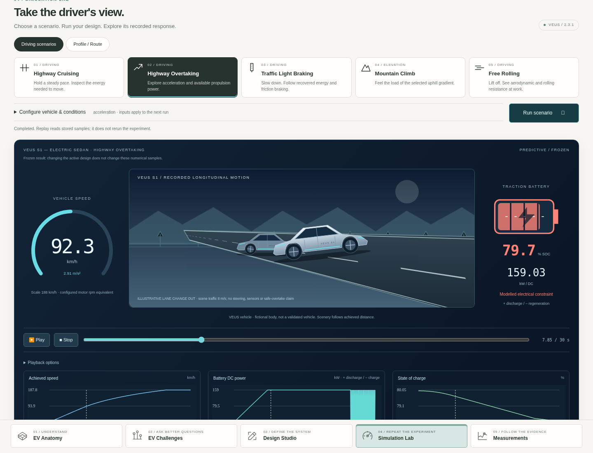
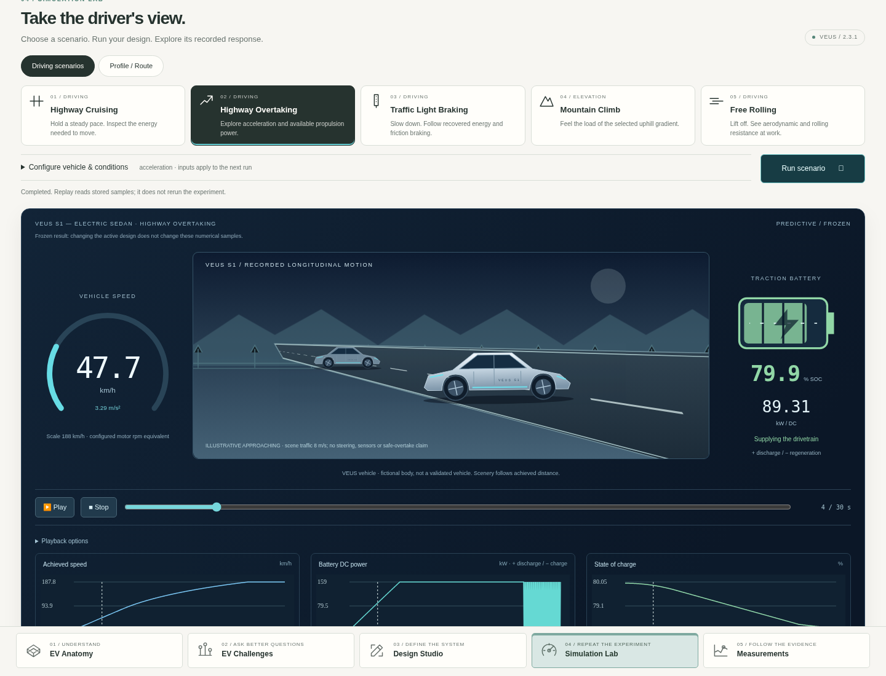

# VEUS 2.6 evidence

Baseline `ae636e43d8f0069438842b4f4fba0ae0976d54c8`, feature branch only.
Checkpoints A → B → C passed sequentially; physical validation is **INCONCLUSIVE**.
No main merge, stable release or Phase 3.0.

## Acceptance and reproducibility

- [A](checkpoint-A.json): 50 focused Python checks plus browser map/legacy comparison.
- [B](checkpoint-B.json): 7 focused Python checks including exact legacy measurement
  JSON/CSV/HTML parity, VED readiness, paired-error arithmetic and disjoint split guards.
- [C](checkpoint-C.json): 8 pure scene checks and browser seeks, wheel mapping, traffic,
  lane transitions, rate/pause/Stop, reduced motion, responsive layout and cleanup.
- [Final verification](verification.json): **314 Python tests**, **9 clock + 8 scene
  tests**, **9 browser suites** (all 8 baseline suites plus advanced). One existing
  testclient/httpx deprecation warning; no dependency change. No test was weakened.

Run the Python suite with the project interpreter and `-m pytest -q`; run clock/scene
checks with `node --test tests/browser/replay-controller.test.cjs tests/browser/driving-scene-state.test.mjs`.
Browser suites are listed in verification.json; set PLAYWRIGHT_MODULE, CHROMIUM_PATH,
VEUS_CAPTURE=0 and VEUS_URL. Legacy drive/replay/guidance/investigation use `/engineering`;
modern suites use the root. Full Python regression ran once after the focused gates.
A mistaken root URL in the first legacy replay invocation was corrected and passed;
this was a harness invocation error, not a product fix.

## Same-design model comparison

[Compact frozen example](model-comparison-summary.json) includes the full request,
model/configuration/run hashes, summaries and assumptions. It is explicitly a projection,
not the full hashed export. POST its `request` to `/api/workbench/v2/powertrain-comparison`
to regenerate the complete response, including operating-point previews and frozen map.

S1, complete 120 s urban cycle, 0.2 s step, 0.861 km achieved, continuous ratings:

| Quantity | Constant legacy | Illustrative map |
| --- | ---: | ---: |
| Stored-energy depletion, kWh/100 km | 11.1893 | 12.8316 |
| Net terminal consumption, kWh/100 km | 11.0613 | 12.6821 |
| Cycle-equivalent range, km | 536.22 | 467.59 |
| 0–100 km/h tick time, s | 8.8 | 8.8 |
| Cycle motor/inverter/gear conversion loss, kWh | 0.039060 | 0.053015 |

The map changes illustrative loss assumptions; these differences are **not improvements
or deterioration measured on a physical vehicle**. Range extrapolates this short cycle
using the model reservoir and is not certified range or remaining range at current SOC.
Map diagnostics separate motor, inverter and gearbox losses. Continuous acceleration can
remain torque/power-limited with the same target tick despite different electrical losses.
See [equations and boundary limitations](../powertrain2.6.md).

## Real-data readiness

[Actual JSON assessment](validation.json) and [HTML report](validation.html) preserve
source provenance, full request and model fingerprint. Leaf VED identity/channels do
not independently match an illustrative preset. Test mass, tyres/aero/drivetrain,
current polarity, synchronization and uncertainty remain insufficiently verified.
No actual calibration fit, matched residuals or physical validation are asserted.
The reports record candidate initial values, identifiability blockers and null fit/error
fields. [Contracts and limitations](../validation-driving2.6.md).

## Actual browser captures

These are the two requested Chromium captures, not generated illustrations. Both use
actual stored S1 longitudinal samples; traffic/lateral/camera choreography is explicitly
illustrative. Captured before the small version-badge text update to 2.6.

## Essential comparable performance

Existing measurement scripts, warm-up excluded, three shared-cloud samples. Initial
subresources are decoded response bodies, not compressed network transfer or disk size.
RSS is server process memory, not browser heap. No laptop performance guarantee.

| Metric | 2.5 baseline | 2.6 |
| --- | ---: | ---: |
| Initial subresource bodies, bytes | 98,233 | 98,289 |
| Startup RSS, KiB | 44,172 | 44,408 |
| Post-evaluation RSS, KiB | 49,648 | 49,952 |
| Startup median, s | 0.464 | 0.748 |
| Legacy urban + acceleration Insights median, ms | 156.1 | 148.4 |
| Browser load including network-idle wait, ms | 715 | 745 |
| Browser idle main-thread task fraction, % | 0.177 | 0.207 |
| Idle server CPU, 1 s sampling, % | 0 | 0.998 |

[Server before](performance-before.json) / [after](performance-after.json),
[browser before](browser-before.json) / [after](browser-after.json).
One CPU tick is about 1% in a one-second server sample; the tiny idle sample does not
establish zero CPU use. Browser samples have **zero background requests, WebSockets,
pending application timeouts, intervals and animation frames** in static workspaces.
The advanced workflow additionally checks inactive/paused Lab frame cleanup. Variability
and concurrent shared-host load prevent interpreting latency differences as a speedup.

[Same-server optional-map timing](map-runtime.json): S1 urban + continuous acceleration,
legacy median **105.6 ms / 134,089 HTTP JSON bytes**, mapped **150.5 ms / 264,452 bytes**.
The mapped preview adds operating-point diagnostics; both calculations are click-driven.
This separate sample is not directly interchangeable with the startup-script trial.
No runtime dependency, polling service, game engine or 3D framework was added.
