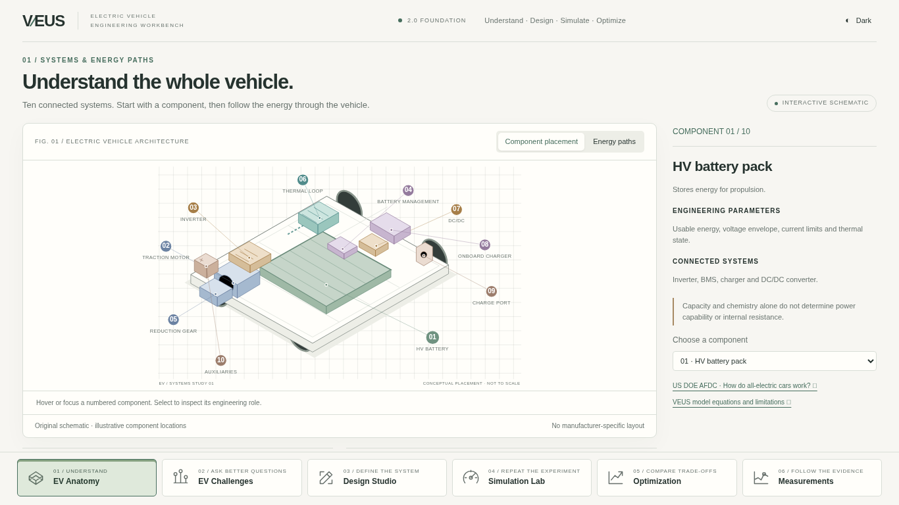
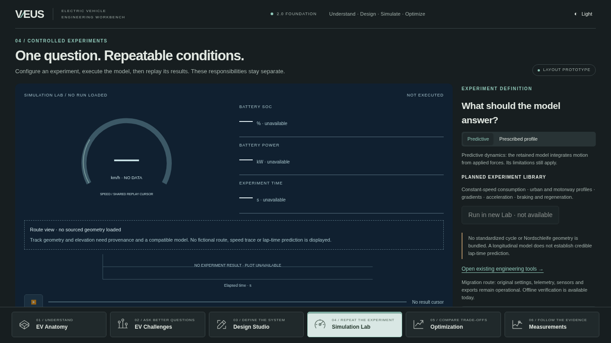

# VEUS 2.0 foundation review evidence

This branch completes **Foundation and UX Redesign** only. No stable 2.0 release,
advanced engineering models, main merge or physical-validation claim is included.
Read the [audit and retirement decisions](../audit.md), [architecture](../architecture.md),
[roadmap](../roadmap.md) and [source review](../sources.md).

## What works and what is a prototype

| Workspace      | Foundation state                            | Review focus                                                                                                                       |
| -------------- | ------------------------------------------- | ---------------------------------------------------------------------------------------------------------------------------------- |
| EV Anatomy     | Functional                                  | Ten original SVG components, focus/hover descriptions, selection inspector, electrical paths, EV/combustion comparison             |
| EV Challenges  | Functional explanatory content              | Eight engineering topics, four-stage question structure, references and limitations                                                |
| Design Studio  | Interaction prototype with working contract | Illustrative values, field-to-subsystem highlighting, bounded backend validation and JSON round-trip; no simulator adapter         |
| Simulation Lab | Frontend prototype                          | Navy instruments, predictive/prescribed distinction, unavailable readouts and disabled run/replay controls; working migration link |
| Optimization   | Frontend prototype                          | Controlled study definitions, objective/constraint explanations, no fabricated improvements                                        |
| Measurements   | Real metadata + frontend prototype          | Existing genuine catalogue, question selection and actual source counts/gaps; original investigation/import/export tools linked    |

No old backend physics or controllers are modified. Retired functionality is absent
from the new default loading graph. The previous application remains isolated at
`/engineering` until essential engineering replacements pass parity checks. No code
files or useful tests are deleted; see [the per-file inventory](../retirement-matrix.json).

## Actual application captures

Captured in headless Chromium at **1366 × 768**, with a **390 × 844** mobile capture.
The diagrams are original VEUS SVG geometry, not copied source artwork or generated
screens. All 15 screenshots total approximately 1.81 MiB; exact sizes, dimensions and
hashes are in [screenshots.json](screenshots.json). Laptop screenshots show the actual
viewport, not a fabricated composite. No physical component positioning is asserted.

| Workspace               | Light                                     | Dark                                    |
| ----------------------- | ----------------------------------------- | --------------------------------------- |
| EV Anatomy              | [Light view](anatomy-light.png)           | [Dark view](anatomy-dark.png)           |
| EV Challenges           | [Light view](challenges-light.png)        | [Dark view](challenges-dark.png)        |
| Design Studio           | [Light view](design-light.png)            | [Dark view](design-dark.png)            |
| Simulation Lab          | [Light view](simulation-light.png)        | [Dark view](simulation-dark.png)        |
| Optimization            | [Light view](optimization-light.png)      | [Dark view](optimization-dark.png)      |
| Measurements            | [Light view](measurements-light.png)      | [Dark view](measurements-dark.png)      |
| AC charging energy path | [Light schematic](energy-paths-light.png) | [Dark schematic](energy-paths-dark.png) |




[Mobile anatomy](anatomy-mobile.png). The EV schematic is fully visible above the
dock on the target laptop. Long fieldsets/detail content scroll above the fixed dock;
mobile component selection also has a native dropdown alternative to SVG targets.

## Executed verification

| Check                            | Result     | Evidence                                    |
| -------------------------------- | ---------- | ------------------------------------------- |
| Baseline Python suite            | 187 passed | [Baseline output](baseline-tests.txt)       |
| Final Python suite               | 207 passed | [Final output](python-tests.txt)            |
| Playback-clock suite             | 9 passed   | [Clock output](clock-tests.txt)             |
| New workbench browser            | PASS       | [Structured result](workbench-browser.json) |
| Historical Drive browser         | PASS       | [Result](legacy-drive.json)                 |
| Historical Replay browser        | PASS       | [Result](legacy-replay.json)                |
| Historical Guidance browser      | PASS       | [Result](legacy-guidance.json)              |
| Historical Investigation browser | PASS       | [Result](legacy-investigation.json)         |
| Python lint, new modules/tests   | PASS       | Ruff 0.14.3, `--select F,E9`                |
| Dependency consistency           | PASS       | `pip check`; exact freeze unchanged         |

Twenty new backend cases cover the isolated root/migration route, sourced-content
structure, deterministic configuration serialization, invalid voltage/power/capacity
and version/type envelopes, non-finite values, bounded requests, technology-label
non-inference and actual retained VED energy/coverage gates. No test is discarded.
Two historical HTML assertions now address `/engineering`, preserving every original
assertion; the four historical browser defaults change only their entry URL.

The new browser suite checks all ten component targets, keyboard Enter/Space,
hover/focus descriptions, energy modes, challenge navigation, invalid/valid design
validation, file export/import, escaped input, tab arrow navigation, browser history,
theme persistence, six-workspace screenshots and overflow at widths 1366, 1024,
820 and 390. It asserts no legacy script fetch and **zero WebSocket connections**
from the new shell, unavailable prototype values and accessible migration links.
These are functional checks, not a full accessibility certification or a Windows
hardware performance benchmark. All browser suites report no page errors.

Reproduction from the repository root, after starting Uvicorn:

```bash
python -m pytest -q
node --test tests/browser/replay-controller.test.cjs
# Optional external Playwright/Chromium tooling; no app dependency added.
node tests/browser/workbench.cjs
node tests/browser/drive.cjs
node tests/browser/replay.cjs
node tests/browser/guidance.cjs
node tests/browser/investigation.cjs
```

Set `PLAYWRIGHT_MODULE`, `CHROMIUM_PATH`, `VEUS_URL` and `VEUS_SCREENSHOTS` for your
environment. New tests default to port 8770; legacy suites default to its
`/engineering` path. For a different host/port, provide that full migration URL for
legacy suites. The new suite captures screenshots and a JSON report in `/tmp` by default.
One existing Starlette/httpx deprecation warning remains; it is not introduced here.

## Measured footprint and startup

Actual raw measurements: [baseline.json](baseline.json), [post-change.json](post-change.json).
The baseline stores exact dependency versions and SHA256 values for existing Python
sources. Hash comparison confirms that **only `studio/main.py` changed among existing
Python application files**; retained model/control/sensor/runner/import source is identical.

| Measurement                                                     |           Baseline |  Foundation |
| --------------------------------------------------------------- | -----------------: | ----------: |
| Summed Python-environment file bytes                            |        297,534,332 | 297,534,332 |
| Tracked static-directory file bytes (migration assets retained) |            211,386 |     275,758 |
| New shell HTML body bytes                                       | 22,413 (old entry) |       1,812 |
| Interpreter + module import wall time                           |            0.331 s |     0.383 s |
| Time to first successful root HTTP response                     |            0.386 s |     0.356 s |
| Server RSS after first root response                            |         42,032 KiB |  42,328 KiB |
| Import-process peak RSS                                         |         36,068 KiB |  36,332 KiB |

The new shell files total **64,372 bytes**, including HTML/CSS/JS/SVG. Existing static
files remain for migration, so total stored frontend size increases. Exact dependency
freeze and summed environment bytes are unchanged. No frontend framework, 3D engine,
ML dependency or external font is added.

These are **single cloud Linux snapshots**, warm filesystem, 20 ms HTTP polling,
not statistical performance comparisons. They do not demonstrate a speedup, target
laptop memory budget, GPU usage, or production readiness. Browser startup resource
sizes and an available Chromium heap snapshot are retained in the structured browser
result; they are not measurements of total browser RSS. Archive and screenshot files
are excluded from the frontend-directory measurement.

## Known limitations and review boundary

- Source-referenced qualitative descriptions are not manufacturer product records.
  DOE AFDC live retrieval was blocked by the cloud proxy (HTTP 403); no retrieval
  date or latest source-page review is fabricated. VED retrieval succeeded.
- Design checks validate declared nameplate envelopes only; current, cooling,
  transient, insulation, packaging, safety and control compatibility still need work.
- No persistent design library, commercial catalogue, range/cost/charging-time model,
  cycle adapter or performance prediction is implemented in the new shell.
- The retained old UI still includes manual driving and ADAS because of shared
  dependencies, explicitly outside the new product's primary UX. Delete it only
  after replacement measurement/calibration/simulation workflows pass equivalence.
- Lab routes, plotted traces, times and optimization outcomes stay unavailable.
  No fictional track geometry, standardized cycle or lap-time prediction is added.
- VED gaps/current polarity and Phase 8's **INCONCLUSIVE** physical-validation result
  are unchanged. Replay never becomes evidence of predictive model accuracy.

This is the foundation review milestone. Further engineering implementation follows
explicitly scoped, verified roadmap steps; no additional production phase is started here.
